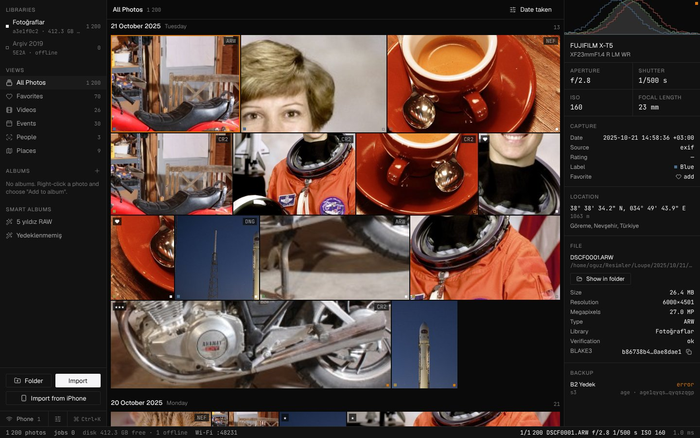
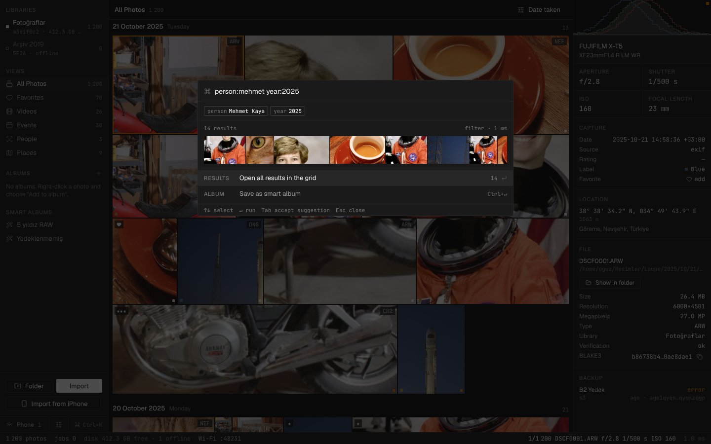

# Loupe

A local-first photo catalog with offline face recognition and semantic search, Wi-Fi transfer from your phone, and encrypted cloud backup. Your photos stay on your own disks; Loupe only indexes, organizes and protects them.

The interface is available in English and Turkish (Settings → language switch at the top right).

*Yerel ve çevrimdışı fotoğraf arşivi: yüz tanıma, anlamla arama, telefondan Wi-Fi ile aktarım ve şifreli bulut yedeği. Google Photos / Lightroom kataloğuna gizlilik odaklı bir alternatif.*



<sub>Screenshots are from the browser demo mode (`npm run dev` in `apps/desktop`) with sample images, so the names, places and EXIF values are made-up demo data.</sub>

## Features

- **Catalog in place or import.** Add existing folders as references, or import from a folder, a memory card or an iPhone over USB with copy, move or hard link. Files land in date-based folders you choose (`{yyyy}/{mm}/{dd}`, with an optional subfolder). Duplicates are recognized by content and skipped.
- **Fast timeline.** Justified grid that stays smooth with 100,000+ photos; sort by date taken, date added, name, size or rating; group by day, month or year. RAW (CR2, NEF, ARW, DNG), HEIC, JPEG, PNG, WebP and video.
- **People, events, places.** Offline face detection and clustering (SCRFD + ArcFace), automatic events from time and location, reverse geocoding without a network connection.
- **Search by meaning.** Ctrl+K opens a palette that mixes natural language ("snow in the mountains", "kitchen") with filters such as `person:anna year:2024 rating:4 place:Dubai`. Save any search as a smart album.
- **Albums, favorites, slideshow.** Manual albums, favorites, ratings and color labels written to XMP sidecars, full-screen slideshow (S).
- **Phone transfer without an app.** Scan a QR code and send photos from the phone's browser over your local network (TLS, resumable uploads, BLAKE3 verification). An iOS Shortcut can send whole albums.
- **Encrypted backup.** End-to-end encryption with [age](https://age-encryption.org) to S3, Backblaze B2, Cloudflare R2, Wasabi, WebDAV or a local/NAS folder, with bandwidth limits and a recovery key.
- **Bit-rot check.** "Verify Library" re-hashes every file and reports missing or corrupted ones.



## Install

Download the installer for your system from [Releases](https://github.com/kaptanoguz/Loupe/releases).

| System | File | Notes |
|---|---|---|
| Ubuntu, Debian, Linux Mint | `*.deb` | `sudo apt install ./Loupe*.deb`. The package is called `loupe-photos` so it never collides with GNOME's unrelated "loupe" image viewer. |
| Other Linux | `*.AppImage` | `chmod +x` and run it. If it fails with "Failed to register AppImage in system via libappimage", an old AppImageLauncher (2.x) is intercepting it: `sudo apt remove appimagelauncher` fixes it. |
| macOS (Apple Silicon / Intel) | `*_aarch64.dmg` / `*_x64.dmg` | The app is not signed yet: right-click → Open the first time. |
| Windows | `*-setup.exe` or `*.msi` | Not signed yet: SmartScreen → More info → Run anyway. |

Face recognition and semantic search need the models (about 2.7 GB, verified with SHA-256): Settings → AI → Download models. On macOS and Windows the AI features and iPhone USB import are not available yet; everything else works.

Upgrading from a build installed as `loupe`: install the new `.deb`, then `sudo apt-mark unhold loupe` if you had held it. The new package replaces the old one.

## Build from source (Linux)

```sh
make deps      # Debian/Ubuntu: WebKitGTK 4.1, GTK 3, libvips (install Rust and Node 22 separately)
make models    # SCRFD, ArcFace, M-CLIP and ONNX Runtime → ~/.local/share/loupe/models (SHA-256 verified)
make bundle    # target/release/bundle/deb/*.deb and appimage/*.AppImage
make dev       # development with hot reload
make test      # everything CI runs
```

Releases for all platforms are built by [`.github/workflows/release.yml`](.github/workflows/release.yml) when a `v*` tag is pushed; the installers are attached to a draft release.

## Development

```sh
cargo test --workspace
cargo clippy --workspace --all-targets -- -D warnings   # unwrap/expect/panic in production code fail the build
cargo fmt --check
# Real models: ONNX Runtime is downloaded into the model directory by `make models`
# (or point ORT_DYLIB_PATH at a system libonnxruntime.so)
cargo clippy -p loupe-ai --features ort --all-targets -- -D warnings
cargo clippy -p loupe-app --features ort --all-targets -- -D warnings
# Without models, AI starts switched off (events still work). LOUPE_AI=mock enables a
# deterministic test model; LOUPE_SECRETS=file skips the Secret Service keyring.
scripts/fetch-models.sh status     # also: install | verify | pin
make mobile                        # test server for the phone page (prints the QR address)

# Interface (apps/desktop): Svelte 5 + Tailwind v4
cd apps/desktop && npm ci
npm run dev            # in the browser with a fake catalog; large library: http://localhost:5173/?mock=100000
npm run check && npm test && npm run build
npx tauri dev          # the real app (needs WebKitGTK 4.1 on Linux)
```

Interface strings live in [`apps/desktop/src/lib/i18n/`](apps/desktop/src/lib/i18n/): `tr.ts` defines the keys and `en.ts` must translate every one of them (the type checker enforces it).

## Architecture

| Crate | Contents |
|---|---|
| `loupe-core` | IDs, `Blake3Hash`, `PHash`, `RelPath` (NFC), schema enums, catalog traits |
| `loupe-db` | SQLite pool (WAL, NORMAL, mmap), embedded migrations, sqlite-vec, batched `BEGIN IMMEDIATE` writes |
| `loupe-storage` | Volume/UUID resolution and relocation, single-pass BLAKE3 + pHash, atomic importer (copy/move/hard link), debounced watcher, Verify Library; Linux, macOS and Windows |
| `loupe-media` | EXIF for JPEG, PNG, WebP, HEIC and RAW; time zones and GPS; offline GeoNames R-tree; XMP and `.loupe.json` sidecars; RAW previews; WebP thumbnails (optional libvips); video via ffmpeg |
| `loupe-jobs` | Persistent SQLite job queue with viewport priority, worker pool, pause and resource modes, exponential backoff and dead letters |
| `loupe-ai` | Model manager (manifest, resumable downloads, SHA-256), SCRFD + ArcFace + M-CLIP via ONNX Runtime, incremental face clustering, event detection |
| `loupe-search` | Hybrid search combining people, places, time, events, ratings, labels, camera/lens and natural language (CLIP + keywords, RRF); smart albums |
| `loupe-lan` | mDNS discovery, QR pairing, mTLS (TLS 1.3, HTTP/2), the app-free phone page, tus.io resumable uploads with BLAKE3 verification, phone-edit conflict policies |
| `loupe-cloud` | age encryption, recovery key, S3-compatible / WebDAV / local providers, sync state machine, bandwidth limiting, verified restore |
| `loupe-app` | The desktop core without Tauri (fully testable): libraries, imports, timeline, inspector, albums, people, events, palette, AI, LAN and cloud services |
| `apps/desktop` | Tauri v2 shell and the Svelte 5 interface |

Design documents (in Turkish) are in [`docs/rfc/`](docs/rfc/). Schema: [`crates/loupe-db/migrations/`](crates/loupe-db/migrations/), checked by `python3 tools/schema-check/check_schema.py crates/loupe-db/migrations`. Design system: [`apps/desktop/src/app.css`](apps/desktop/src/app.css), guarded by `tools/slop-guard/slop-guard.sh`.

## License notes

The face models (InsightFace) are licensed for non-commercial use only.
