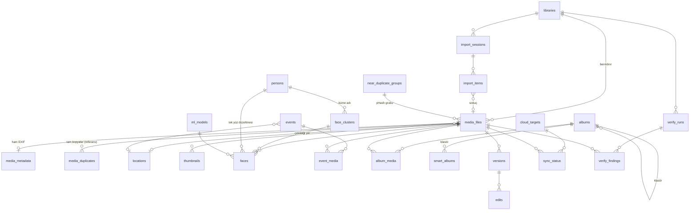
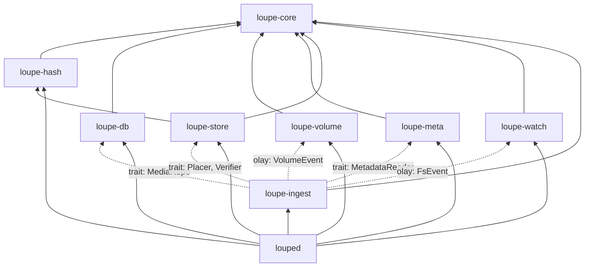
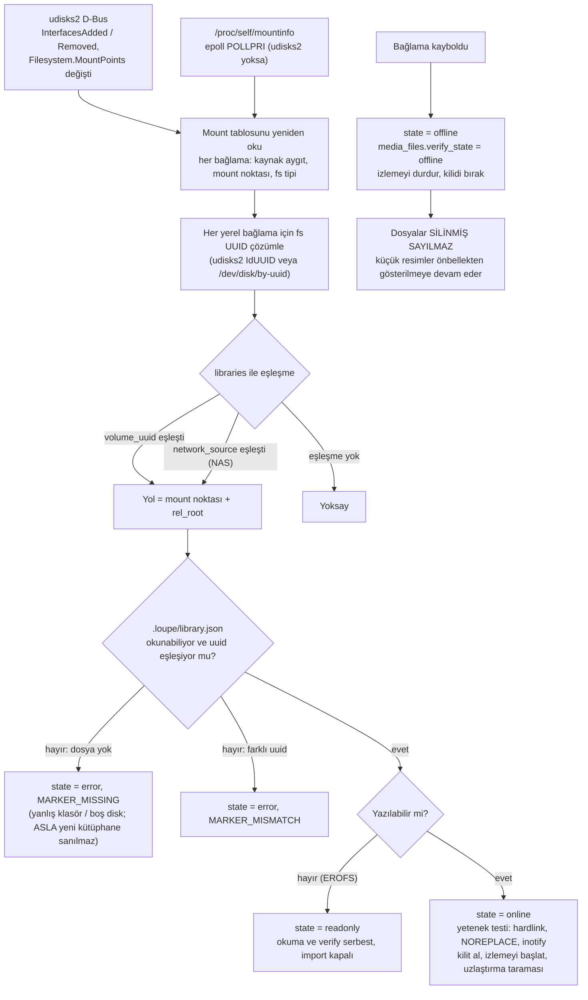
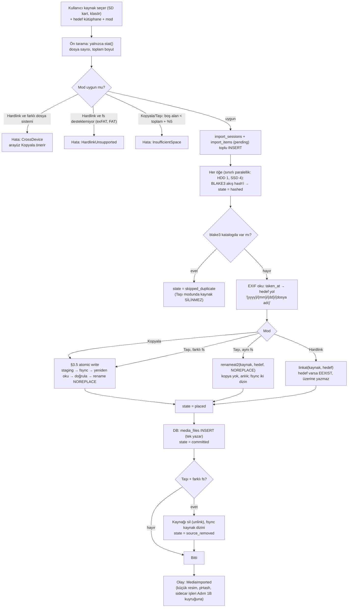
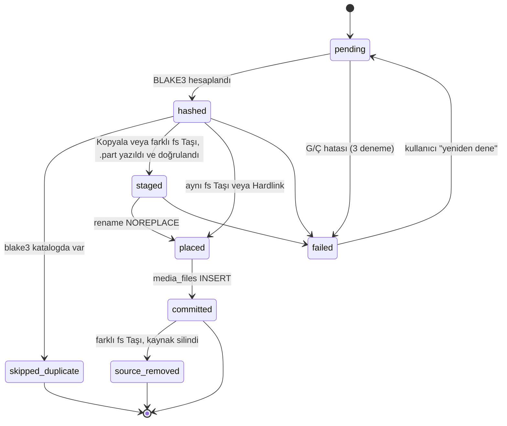
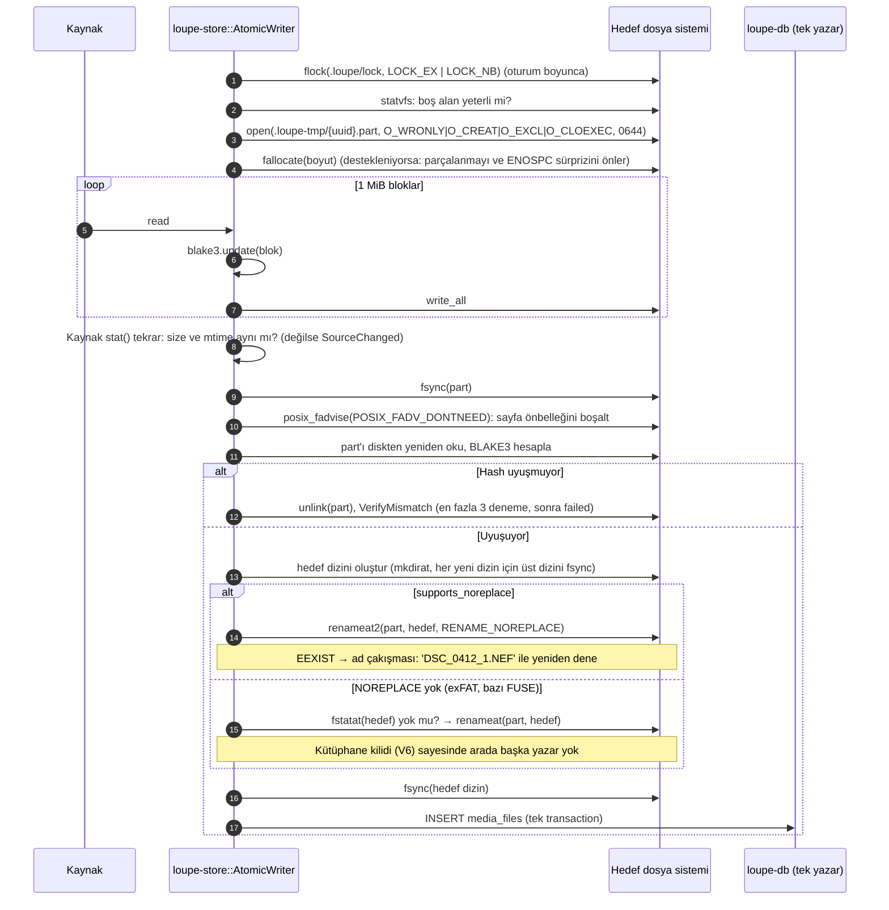
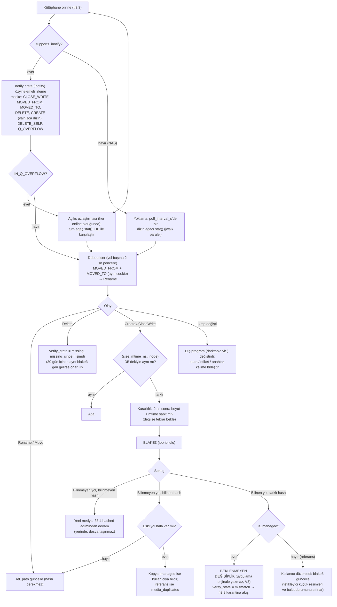
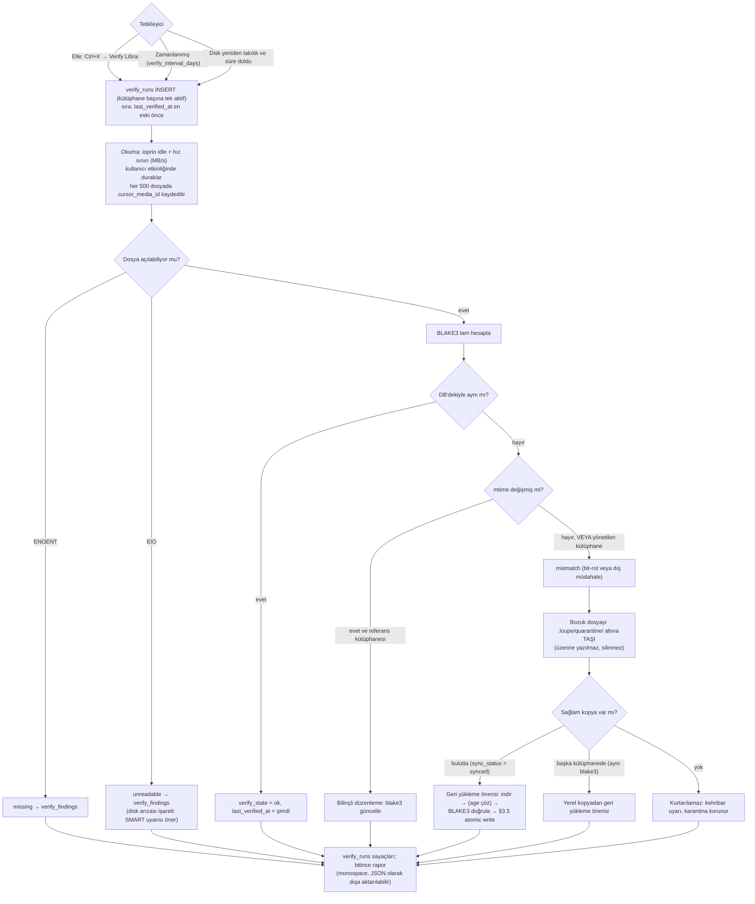

# RFC-001A — Veritabanı ve Depolama Mimarisi

| Alan | Değer |
|---|---|
| Durum | **Taslak — onay bekliyor** |
| Tarih | 2026-10-25 |
| Kapsam | SQLite şeması (tam SQL), dosya sistemi / import / atomic write / disk UUID takibi / BLAKE3 + pHash / bit-rot |
| Kapsam dışı (Adım 1B) | AI iş kuyruğu (`jobs`, `sync_queue`), LAN Sync el sıkışması (`devices`, `lan_transfers`), Anti-Slop CSS tasarım sistemi |
| Şema dosyası | [`crates/loupe-db/migrations/0001_initial.sql`](../../crates/loupe-db/migrations/0001_initial.sql) |
| Şema testi | [`tools/schema-check/check_schema.py`](../../tools/schema-check/check_schema.py) |

---

## 0. Kesin kararlar (sabit yığın)

| Alan | Karar |
|---|---|
| Çekirdek ve masaüstü | Tauri v2 + Rust (backend) + Svelte 5 (Runes) + Tailwind CSS |
| Küçük resim hattı | `libvips` + `LibRaw`; arayüze aktarım `thumb://` Tauri özel protokolü ile (JSON IPC yok) |
| Veritabanı | Tek motor **SQLite** (WAL, `synchronous=NORMAL`, `mmap` açık). DuckDB yok |
| Vektör | `sqlite-vec` (bu şemada asıl kopya); `usearch` gerekirse türetilmiş önbellek dizini |
| LAN | mDNS + `tus.io` (HTTP/2 over TLS). WebTransport yok |
| Şifreleme | `age` (`rage` crate) |

## 0.1 Bu belgedeki varsayımlar

| # | Varsayım |
|---|---|
| V1 | Tek kullanıcı, tek masaüstü, Linux (x86_64 / aarch64), 100k–500k medya. |
| V2 | **Katalog veritabanı her zaman yerel diskte** (`$XDG_DATA_HOME`). SQLite'ın kilitleme modeli NFS/SMB üzerinde güvenilir değildir; NAS'ta yalnızca medya dosyaları durur. |
| V3 | Uygulama orijinal dosyalara **asla yazmaz**. Kullanıcı verisi (puan, etiket, düzenleme) veritabanında ve sidecar dosyalarında (`.xmp`, `.loupe.json`) tutulur. |
| V4 | Import modları: **Kopyala**, **Taşı**, **Hardlink**. Bunlara ek olarak mevcut bir klasör **referans kütüphanesi** olarak eklenebilir (`is_managed = 0`): dosyalara dokunulmaz, yeniden adlandırılmaz, `YYYY/MM/DD` düzeni zorlanmaz. |
| V5 | Tam kopya engeli **kütüphaneye yeni yazılan** dosyalar içindir. Referans kütüphanesinde zaten var olan tam kopyalar silinmez; `media_duplicates` tablosunda raporlanır. |
| V6 | Her kütüphaneye aynı anda yalnızca **bir** `louped` süreci yazar (kütüphane kilidi, §3.5). Bu, `RENAME_NOREPLACE` olmayan dosya sistemlerindeki yedek yolun güvenliğinin temelidir. |

---

## 1. Genel yerleşim

```
$XDG_DATA_HOME/loupe/
└── catalog.db  (+ -wal, -shm)              # tek doğruluk kaynağı (metadata)

$XDG_CACHE_HOME/loupe/thumbs/
└── 9f/9f2c…41ad_grid.webp                  # silinebilir; blake3 ile adlandırılır

<KÜTÜPHANE_KÖKÜ>/                           # örn. /run/media/oguz/Arsiv-4TB/Fotograflar
├── .loupe/
│   ├── library.json                        # { "uuid": "…", "schema": 1, "created_at": … }
│   ├── lock                                # flock: tek yazar (V6)
│   ├── quarantine/                         # verify'da bozuk bulunan dosyalar
│   └── manifest.jsonl                      # periyodik, okunabilir katalog dökümü
├── .loupe-tmp/                             # atomic write geçici alanı (AYNI dosya sistemi; Adım 2A)
└── 2026/10/24/
    ├── DSC_0412.NEF
    ├── DSC_0412.xmp                        # puan, renk etiketi, anahtar kelime, kişi bölgeleri
    └── DSC_0412.loupe.json                 # düzenleme yığını vb. (XMP'nin ifade edemediği)
```

**Kilitlenmeme garantisi:** Uygulama silinse bile kullanıcıda okunabilir klasör ağacı, standart XMP sidecar'ları (Lightroom, darktable ve digiKam okuyabilir) ve JSONL manifest kalır.

---

## 2. Veritabanı

### 2.1 Bağlantı ayarları

PRAGMA'ların çoğu bağlantı başınadır, bu yüzden migrasyon dosyasında değil `loupe-db` içinde, her bağlantı açılışında uygulanır:

```rust
// crates/loupe-db/src/conn.rs (tasarım; Adım 2'de yazılacak)
pub fn open(path: &Path, role: Role) -> Result<Connection, DbError> {
    let flags = match role {
        Role::Writer => OpenFlags::SQLITE_OPEN_READ_WRITE | OpenFlags::SQLITE_OPEN_CREATE,
        Role::Reader => OpenFlags::SQLITE_OPEN_READ_ONLY,
    } | OpenFlags::SQLITE_OPEN_NO_MUTEX;
    let conn = Connection::open_with_flags(path, flags).map_err(DbError::Open)?;
    sqlite_vec::load(&conn).map_err(DbError::Extension)?;
    conn.execute_batch(
        "PRAGMA journal_mode = WAL;
         PRAGMA synchronous = NORMAL;      -- WAL'da güvenli: commit edilen veri çökmede kaybolmaz,
                                           -- yalnızca elektrik kesintisinde son commit'ler gidebilir
         PRAGMA foreign_keys = ON;
         PRAGMA busy_timeout = 5000;
         PRAGMA mmap_size = 268435456;     -- 256 MiB
         PRAGMA cache_size = -65536;       -- 64 MiB
         PRAGMA temp_store = MEMORY;
         PRAGMA journal_size_limit = 67108864;
         PRAGMA trusted_schema = OFF;",
    ).map_err(DbError::Pragma)?;
    register_functions(&conn)?;           // hamming(a, b): pHash karşılaştırması
    Ok(conn)
}
```

- **Tek yazar aktörü:** Tüm yazmalar tek bir bağlantı üzerinden, bir `tokio` kanalıyla sıraya alınır ve 500 komut veya 100 ms'de bir toplu transaction olarak işlenir. Okumalar ayrı salt-okunur bağlantı havuzundan yapılır. Bu modelde `SQLITE_BUSY` yapısal olarak oluşmaz.
- **`synchronous = NORMAL` ve dosya güvenliği:** Elektrik kesintisinde en son commit edilen birkaç transaction kaybolabilir, ama veritabanı **bozulmaz**. Dosyalar her zaman veritabanından **önce** diske yazılıp `fsync` edildiği için (§3.5) kaybolan bir kayıt, açılıştaki uzlaştırma taramasıyla geri kazanılır. Bu yüzden `FULL` gerekmez.
- **Checkpoint:** `wal_autocheckpoint` varsayılan; ayrıca boşta kalındığında `PRAGMA wal_checkpoint(TRUNCATE)`.

### 2.2 Varlık-İlişki diyagramı



Sanal vektör tabloları (`vec_faces`, `vec_face_centroids`, `vec_media_clip`) diyagramda yok; FK desteklemedikleri için silme tetikleyicilerle yayılır.

### 2.3 Tablolar ve tasarım kararları

Tam SQL: [`0001_initial.sql`](../../crates/loupe-db/migrations/0001_initial.sql) (24 tablo, 3 vektör tablosu, 1 view, 16 tetikleyici). Aşağıda yalnızca **neden**ler var.

| Tablo | Kritik kararlar |
|---|---|
| `libraries` | Kütüphane **mount yoluyla değil**, `volume_uuid` + `rel_root` (mount noktasına göre yol) ile tanımlanır; NAS için `network_source`. `last_mount_path` yalnızca ipucudur. Çıkarılabilir disk UUID'siz, ağ diski kaynaksız eklenemez (`CHECK`). Dosya sistemi yetenekleri (`supports_hardlink`, `supports_noreplace`, `supports_inotify`) bağlanınca ölçülür ve import stratejisini belirler. |
| `media_files` | **`blake3 UNIQUE`**: tam kopya engeli uygulama mantığına değil veritabanına bağlıdır; yarış durumunda bile ikinci kayıt oluşamaz. `(library_id, rel_path) UNIQUE`. Zaman çizelgesi için kısmi indeks (`WHERE soft_deleted_at IS NULL`) ve `(taken_at_utc, id)` ile imleç tabanlı sayfalama (OFFSET yok). `verify_state` + `last_verified_at` + `missing_since` bit-rot ve kayıp dosya takibi için. `(device_id, inode)` indeksi izleyicinin rename ve hardlink tespiti için. |
| `media_files.phash` | 64-bit DCT pHash, işaretli `INTEGER`. 4 adet 16-bitlik **bant ifade indeksi**: Hamming ≤ 3 olan her çift en az bir bantta birebir eşleşir (güvercin yuvası). Daha gevşek eşik (≤ 8) yalnızca zaman penceresinde aranır (§3.6). |
| `near_duplicate_groups` | Yakın kopyalar silinmez, gruplanır. `keeper_media_id` ve `reviewed_at` ile kullanıcının kararı kalıcıdır; aynı grup tekrar önerilmez. |
| `import_sessions`, `import_items` | Her dosyanın import durumu kalıcıdır (`pending → hashed → staged → placed → committed → source_removed`). **Taşı** modunda kaynak silme ancak `committed` sonrası yapılır ve çökme sonrasında yarım kalan oturum kaldığı yerden devam eder. |
| `media_duplicates` | Referans kütüphanesinde var olan tam kopyalar (V5). |
| `thumbnails` | **Baytlar DB'de değil**, önbellek dizininde. Tablo envanter ve geçerlilik tutar: `source_blake3` orijinalle uyuşmazsa küçük resim bayattır; içerik değişince tetikleyici satırları siler. `last_access_at` LRU tahliye için. Arayüz dosyayı `thumb://localhost/<media_id>/<size_class>` ile alır (Adım 1B'de ayrıntılı). |
| `persons`, `face_clusters`, `faces` | İsimlendirme **küme seviyesinde**: kümeye kişi atamak tüm yüzlerini adlandırır. Tek yüz düzeltmesi `person_override_id`. Etkin kişi = `COALESCE(override, cluster.person)` (`v_face_person`). `is_confirmed` kümeler yeniden kümelemede bölünmez, `is_ignored` yabancıları gizler, `is_rejected` yanlış tespitleri. Sayaçlar tetikleyiciyle güncel. |
| `vec_*` | sqlite-vec `vec0` tabloları; vektörlerin **asıl kopyası**. Aynı transaction içinde yazıldıkları için medya silinince vektör de silinir, çökmede ayrışma olmaz. `usearch` gerekirse dizini bu tablolardan yeniden üretilen bir önbellektir. |
| `events`, `event_media` | `is_locked` kullanıcı düzenlemesini korur; `event_media.source = 'user_excluded'` satırı **kalıcıdır**, böylece yeniden kümeleme kullanıcının çıkardığı fotoğrafı etkinliğe geri koymaz. |
| `albums`, `album_media` | `position REAL` kesirli sıralama: araya ekleme yeniden numaralandırma gerektirmez. `kind = 'folder'` ile albüm klasörleri. |
| `smart_albums` | `rules` JSON AST'dir (§2.4); **ham SQL saklanmaz**. Rust'ta tipli yapıya ayrıştırılıp parametreli SQL'e derlenir. |
| `versions`, `edits` | Orijinal asla değişmez (V3). `edits` sıralı işlem yığını; `engine_version` eski düzenlemelerin ileride aynı görünmesini sağlar. Her değişiklik `versions.revision`'ı artırır (render önbelleği anahtarı). |
| `cloud_targets`, `sync_status` | Sırlar DB'de **tutulmaz** (`secret_ref` → Secret Service). `sync_status` her (medya, hedef) için `local_checksum` (BLAKE3), `remote_checksum` + algoritması, şifreleme ve anahtar parmak izi, `last_verified_at`, `conflict_status`. `synced` durumu uzak anahtar ve checksum olmadan yazılamaz (`CHECK`). `media_id` için `ON DELETE RESTRICT`: buluttaki kopyası olan medya, uzaktan silinmeden kalıcı silinemez. |
| `verify_runs`, `verify_findings` | Verify Library devam edebilir (`cursor_media_id`); kütüphane başına tek aktif çalıştırma (kısmi `UNIQUE`). Her sorun ayrı kayıt: rapor ve onarım listesi. |

### 2.4 Akıllı albüm kural biçimi

```json
{
  "all": [
    { "field": "rating",          "op": ">=",      "value": 4 },
    { "field": "person",          "op": "in",      "value": [12, 31] },
    { "field": "location.admin1", "op": "=",       "value": "Nevşehir" },
    { "field": "taken_at",        "op": "between", "value": ["2026-01-01", "2026-12-31"] },
    { "any": [
        { "field": "camera_model", "op": "=",       "value": "X100VI" },
        { "field": "color_label",  "op": "in",      "value": ["red", "green"] }
    ] }
  ]
}
```

Alanlar ve operatörler Rust tarafında bir `enum` ile beyaz listededir; bilinmeyen alan ayrıştırma hatasıdır (`SmartAlbumError::UnknownField`), sessizce yok sayılmaz. `rules_version` alanı kural dili değiştiğinde otomatik yükseltme için.

### 2.5 Kritik sorgular

```sql
-- Zaman çizelgesi: imleç tabanlı sayfa (OFFSET yok, 100k'da sabit süre)
SELECT id, taken_at_utc, width, height, thumbhash, rating, color_label, is_favorite
FROM media_files
WHERE soft_deleted_at IS NULL
  AND (taken_at_utc, id) < (:cursor_ts, :cursor_id)
ORDER BY taken_at_utc DESC, id DESC
LIMIT 300;
-- plan: SEARCH media_files USING INDEX media_timeline

-- pHash adayları: 4 bant indeksi, sonra kesin Hamming
SELECT id, hamming(phash, :p) AS d FROM media_files
WHERE phash IS NOT NULL AND (
        (phash & 65535)         = (:p & 65535)
     OR ((phash >> 16) & 65535) = ((:p >> 16) & 65535)
     OR ((phash >> 32) & 65535) = ((:p >> 32) & 65535)
     OR ((phash >> 48) & 65535) = ((:p >> 48) & 65535))
  AND hamming(phash, :p) <= 3;

-- Verify Library: en eski doğrulanandan başla, kaldığı yerden devam
SELECT id, rel_path, blake3, size_bytes, mtime_ns FROM media_files
WHERE library_id = :lib AND (last_verified_at, id) > (:cursor_ts, :cursor_id)
ORDER BY last_verified_at, id
LIMIT 500;
```

`hamming()` Rust'ta `rusqlite::functions` ile kaydedilen deterministik bir fonksiyondur (`(a ^ b).count_ones()`). Şemanın hiçbir yeri (indeks, view, CHECK) ona bağlı değildir, böylece veritabanı standart `sqlite3` aracıyla da açılabilir.

### 2.6 Migrasyon politikası ve doğrulama

- `PRAGMA user_version` + sıralı, değiştirilemez `NNNN_ad.sql` dosyaları; `include_str!` ile binary'ye gömülür. Her migrasyon tek transaction'dır.
- Her migrasyondan önce `VACUUM INTO 'catalog.pre-v<N>.db'` ile otomatik yedek.
- Açılışta `PRAGMA quick_check` (hızlı), haftada bir `PRAGMA integrity_check` + `PRAGMA foreign_key_check`.

**Şema bu belge yazılırken doğrulandı** (`tools/schema-check/check_schema.py`, SQLite 3.45.1 + sqlite-vec 0.1.9):

| Kontrol | Sonuç |
|---|---|
| Migrasyon hatasız uygulanıyor, `integrity_check` = ok, FK ihlali yok | ✓ |
| Aynı BLAKE3 ikinci kez eklenemiyor | ✓ `UNIQUE constraint failed: media_files.blake3` |
| UUID'siz çıkarılabilir disk eklenemiyor | ✓ `CHECK` hatası |
| `synced` durumu uzak checksum olmadan yazılamıyor | ✓ `CHECK` hatası |
| Buluttaki kopyası olan medya silinemiyor | ✓ `FOREIGN KEY constraint failed` |
| İçerik (BLAKE3) değişince küçük resimler siliniyor, `sync_status` → `queued` | ✓ |
| Puan değişince `sidecar_dirty = 1` | ✓ |
| Yüz silinince küme sayacı azalıyor ve vektörü siliniyor | ✓ |
| Etkinlikten çıkarılan fotoğraf sayaçtan düşüyor | ✓ |
| Zaman çizelgesi sorgusu `media_timeline` indeksini, pHash bant sorgusu bant indeksini kullanıyor | ✓ `EXPLAIN QUERY PLAN` |
| Yüz vektörü k-NN araması (`vec_faces MATCH`) | ✓ |

---

## 3. Dosya Sistemi ve Depolama

### 3.1 Rust modül yapısı

```
crates/
├── loupe-core/        Alan tipleri ve ortak hata tipleri (bağımlılığı yok)
├── loupe-db/          Bağlantı, migrasyonlar, tek yazar aktörü, depo (repository) trait'leri
├── loupe-hash/        BLAKE3 akış hash'leme, pHash (DCT)
├── loupe-volume/      Disk kimliği, mount/unmount olayları, dosya sistemi yetenek tespiti
├── loupe-store/       Kütüphane kilidi, düzen şablonu, atomic write, yerleştirme (copy/move/hardlink),
│                      karantina, Verify Library
├── loupe-watch/       inotify + debounce + NAS yoklaması + açılış uzlaştırması
├── loupe-meta/        EXIF/XMP okuma (taken_at, GPS, kamera); sidecar okuma/yazma
├── loupe-ingest/      Import oturumu orkestrasyonu (yukarıdakileri trait'ler üzerinden birleştirir)
└── louped/           Bağlama (wiring): her şeyi başlatır, olay veriyolunu kurar
```



**Ayrıklık kuralları:**
- `loupe-store`, `loupe-watch`, `loupe-volume` veritabanını **bilmez**. Yalnızca dosya sistemiyle konuşur ve tipli sonuç/olay döner.
- `loupe-db` dosya sistemini **bilmez**.
- Birleştirme yalnızca `loupe-ingest`'te, trait'ler üzerinden yapılır; testlerde her biri sahte (fake) uygulamayla değiştirilebilir.
- Modüller arası iletişim sınırlı (bounded) `tokio::mpsc` kanallarıyla: geri basınç doğal olarak oluşur, 50.000 dosyalık bir klasör bırakıldığında bellek sabit kalır.

### 3.2 Temel tipler ve hata tipleri

```rust
// loupe-core
pub struct Blake3Hash(pub [u8; 32]);
pub struct PHash(pub u64);
pub struct LibraryId(i64);
pub struct MediaId(i64);

/// Kütüphane köküne göreli, doğrulanmış yol.
/// Yapıcı yalnızca `RelPath::parse` → mutlak yol, `..` bileşeni, NUL ve boş bileşen reddedilir;
/// Unicode NFC'ye normalize edilir (macOS'tan gelen NFD adlar çift kayıt oluşturmaz).
pub struct RelPath(String);

pub enum ImportMode { Copy, Move, Hardlink }

// loupe-store
#[derive(Debug, thiserror::Error)]
pub enum StoreError {
    #[error("kütüphane kilitli: başka bir süreç yazıyor ({holder})")]
    LibraryLocked { holder: String },
    #[error("yetersiz alan: {needed} bayt gerekiyor, {available} bayt boş")]
    InsufficientSpace { needed: u64, available: u64 },
    #[error("hardlink farklı dosya sistemleri arasında yapılamaz")]
    CrossDevice,
    #[error("dosya sistemi hardlink desteklemiyor ({fs_type})")]
    HardlinkUnsupported { fs_type: String },
    #[error("yazma doğrulaması başarısız: beklenen {expected}, okunan {actual}")]
    VerifyMismatch { expected: Blake3Hash, actual: Blake3Hash },
    #[error("kaynak kopyalama sırasında değişti")]
    SourceChanged,
    #[error("hedef zaten var: {0}")]
    TargetExists(RelPath),
    #[error("G/Ç hatası ({op}) {path}: {source}")]
    Io { op: IoOp, path: PathBuf, #[source] source: std::io::Error },
}
```

Kurallar: `unwrap`, `expect`, `panic` workspace genelinde `deny`. Her `std::io::Error`, hangi işlemde (`IoOp::Fsync`, `IoOp::Rename`…) ve hangi yolda oluştuğuyla sarılır; kullanıcı hata mesajı `ENOSPC`, `EROFS`, `EIO` gibi durumları ayırt edebilir.

### 3.3 Harici disk UUID takibi (`loupe-volume`)



- **Neden iki kaynak:** udisks2 çoğu masaüstünde var ve aygıt kimliğini doğrudan verir; ama sunucu kurulumlarında veya `fstab` ile bağlanan NAS'larda olmayabilir. `mountinfo` her durumda çalışır.
- **Neden işaret dosyası:** Aynı UUID'ye sahip disk klonları ve bağlanmamış bir mount noktasına (boş dizin) yazma riski. `library.json` yoksa uygulama **asla** o dizine yazmaz.
- **Yetenek testi** (`.loupe-tmp/` içinde, bağlanınca bir kez): `link()` denemesi → `supports_hardlink`; `renameat2(RENAME_NOREPLACE)` denemesi → `supports_noreplace` (`EINVAL` ise yok); fs tipi `nfs*`/`cifs`/`fuse.*` ise `supports_inotify = 0` ve `watch_mode = poll`.

### 3.4 Import: Kopyala / Taşı / Hardlink (`loupe-ingest`)



**Mod ayrıntıları:**

| Mod | Kaynak | Ek alan | Atomiklik | Not |
|---|---|---|---|---|
| **Kopyala** | Dokunulmaz | Tam | staging + `RENAME_NOREPLACE` | Varsayılan. Kopyalama sırasında kaynağın `size`/`mtime` değeri değişirse `SourceChanged` ile iptal. |
| **Taşı (aynı fs)** | Yeni yerine taşınır | Yok | `renameat2` tek sistem çağrısı | Hash, rename'den **önce** kaynaktan hesaplanır; içerik rename ile değişmez. |
| **Taşı (farklı fs)** | `committed` sonrası silinir | Geçici | Kopyala + kalıcı durum makinesi | Çökme sonrası `committed` ama `source_removed` değilse silme tekrarlanır; kaynak hash'i önce **yeniden doğrulanır** (aradaki değişiklikte silinmez). |
| **Hardlink** | Aynı inode | Yok | `linkat` hedef varsa başarısız | Yalnızca aynı dosya sistemi. Uyarı: kaynağı düzenleyen bir program kütüphanedekini de değiştirir; bu durum izleyicide "beklenmeyen içerik değişikliği" olarak yakalanır (§3.7). |

**Kaynak SD kart çıkarılırsa:** Oturum `paused` olur, `source_volume` kaydedilir; aynı kart takılınca kaldığı öğeden devam eder (önceki öğeler `committed` olduğu için tekrar yazılmaz).

**`import_items` durum makinesi:**



### 3.5 Atomic write protokolü (`loupe-store`)



**Neden bozuk dosya oluşamaz:**

| Kesinti anı | Diskte | Açılışta |
|---|---|---|
| Yazma sırasında | Yarım `.loupe-tmp/*.part` | `.loupe-tmp/` temizlenir; kaynak yerinde, import oturumu `hashed`'den devam eder. |
| `fsync` sonrası, `rename` öncesi | Tam `.part` | Temizlenir, yeniden yazılır. |
| `rename` sonrası, DB commit öncesi | Hedefte tam ve doğrulanmış dosya, kayıt yok | Uzlaştırma taraması bulur, hash'ler, kayıt ekler (`import_items` `placed` → `committed`). **Kayıp yok.** |
| DB commit sırasında | Dosya yerinde; WAL yarım | SQLite yarım transaction'ı geri alır → yukarıdaki satır. |
| Taşı: commit sonrası, kaynak silinmeden | İki kopya | `committed` öğeler için silme tekrarlanır. |

Değişmez sıra: **dosya → fsync → veritabanı → (varsa) kaynak silme.** Veritabanı hiçbir zaman var olmayan bir dosyaya işaret etmez; ters durum (kayıtsız dosya) kendi kendini iyileştirir.

**Dosya sistemi uyumluluk matrisi** (bağlanınca ölçülen değerlerle çalışılır, tablodaki değerler beklentidir):

| Dosya sistemi | NOREPLACE | Hardlink | inotify | Not |
|---|---|---|---|---|
| ext4, xfs, btrfs | ✓ | ✓ | ✓ | Tam destek |
| exFAT, vfat | çekirdeğe bağlı | ✗ | ✓ | Kilit + `fstatat` yedek yolu; hardlink modu kapalı |
| ntfs3 | ✓ | ✓ | ✓ | |
| NFS v4 | çekirdeğe ve sunucuya bağlı | ✓ | ✗ (uzak değişiklikler) | `watch_mode = poll` |
| SMB/CIFS | çekirdeğe ve sunucuya bağlı | sunucuya bağlı | ✗ | `watch_mode = poll` |

### 3.6 BLAKE3 ve pHash (`loupe-hash`)

| | BLAKE3 | pHash |
|---|---|---|
| Amaç | Tam kopya engeli, bütünlük (bit-rot) | Yakın kopya (seri çekim, yeniden kaydedilmiş, yeniden boyutlandırılmış) |
| Ne zaman | Import sırasında, kopyalanırken akışta (dosya iki kez okunmaz; doğrulama okuması hariç) | Küçük resim üretilirken (aynı decode'dan, ek dosya okuması yok) |
| Girdi | Dosyanın tüm baytları | EXIF yönlendirmesi uygulanmış görüntü → 32×32 gri → DCT → sol üst 8×8 → medyana göre 64 bit. RAW için gömülü önizleme, video için orta kare |
| Paralellik | Büyük dosyalarda `blake3::Hasher::update_rayon`; HDD'de dosya seviyesinde paralellik 1 (arama gecikmesi) | Küçük resim işçileriyle aynı |
| Saklama | `BLOB(32)`, `UNIQUE` | `INTEGER` (64 bit, işaretli) + 4 bant indeksi |

**Yakın kopya gruplama algoritması:**
1. Yeni medyanın pHash'i hesaplanınca, **bant indeksi** ile Hamming ≤ 3 adayları bulunur (zamandan bağımsız: aynı fotoğrafın yıllar sonra yeniden kaydedilmiş kopyası).
2. Ayrıca `taken_at_utc ± 10 dk` penceresindeki medyalarla Hamming ≤ 8 karşılaştırılır (seri çekim).
3. Eşleşme varsa mevcut gruba katılır, yoksa iki medya için yeni grup açılır. Hiçbir dosya silinmez; kullanıcı gözden geçirip `keeper_media_id` seçer.

### 3.7 Sürekli izleme: inotify, debounce, uzlaştırma (`loupe-watch`)



- **Neden `IN_CLOSE_WRITE`, `IN_MODIFY` değil:** Yazımı süren bir dosya asla hash'lenmez. Kararlılık kontrolü, `CLOSE_WRITE` vermeyen yazarlar (bazı senkron araçları) için ek güvencedir.
- **Kendi yazdıklarımız:** `loupe-store` her yerleştirmeden önce hedef yolu bir "beklenen olaylar" kümesine ekler; izleyici bu olayları 10 sn boyunca yok sayar (aksi halde kendi import'umuzu yeniden işleriz).
- **`max_user_watches`:** Başlangıçta dizin sayısı hesaplanır (`YYYY/MM/DD` ile 10 yılda ~3.650 dizin). Limit yetersizse arayüzde net uyarı + `sysctl` komutu; izlenemeyen alt ağaçlar yoklamaya düşer.
- **Rename tespiti:** Aynı `cookie` taşıyan `MOVED_FROM`/`MOVED_TO` çifti tek olaydır. Kütüphane dışından içeri taşınan (yalnızca `MOVED_TO`) dosya "yeni"dir. Çift kaçarsa `(device_id, inode)` indeksi yedek eşleştirmedir.

### 3.8 Verify Library (bit-rot koruması)



- **Bit-rot ile düzenleme nasıl ayrılır:** Gerçek bit-rot `mtime`'ı değiştirmez. Yönetilen kütüphanede ise `mtime` değişmiş olsa bile içerik değişikliği her zaman anomalidir (V3), çünkü uygulama orijinallere yazmaz.
- **Otomatik onarım yok:** Uygulama kullanıcı onayı olmadan hiçbir dosyanın üzerine yazmaz; yalnızca önerir. Karantina silinmez.
- **Varsayılan döngü:** 30 gün; 1 TB'lık kütüphane, 50 MB/s sınırla ~6 saatlik toplam okuma, günlere yayılır.

### 3.9 Test stratejisi (Adım 2'de yazılacak)

- **Çökme enjeksiyonu:** `AtomicWriter` ve import durum makinesinin her adımından sonra süreci `SIGKILL` ile öldüren, ardından yeniden açılışta şu değişmezleri doğrulayan test seti: (1) DB'deki her `media_files` satırının dosyası var ve hash'i doğru, (2) `.loupe-tmp/` boş, (3) hiçbir kaynak dosya `committed` olmadan silinmemiş.
- **Dosya sistemi matrisi:** Aynı testler `ext4`, `btrfs`, `exfat` ve `vfat` loop cihazlarında (CI'da `losetup`).
- **Özellik tabanlı testler** (`proptest`): `RelPath` ayrıştırıcısı, düzen şablonu, ad çakışması çözümü.
- **İzleyici:** Hızlı ardışık rename, aynı anda 10.000 dosya bırakma, `Q_OVERFLOW` simülasyonu.

---

## 4. Onay bekleyen kararlar

| # | Karar | Öneri |
|---|---|---|
| K1 | Varsayılan klasör şablonu | `{yyyy}/{mm}/{dd}`; `{yyyy}/{event}` kütüphane bazında seçilebilir |
| K2 | Varsayılan import modu | Kopyala |
| K3 | Ad çakışması | `DSC_0412_1.NEF` (asla üzerine yazma) |
| K4 | Verify döngüsü | 30 gün, 50 MB/s, kullanıcı etkinliğinde duraklat |
| K5 | Yakın kopya eşikleri | Hamming ≤ 3 (her zaman), ≤ 8 (±10 dk penceresinde) |
| K6 | Silinen dosyanın onarım süresi | 30 gün içinde aynı BLAKE3 geri gelirse kayıt onarılır |

Onaydan sonra **Adım 1B**: AI iş kuyruğu ve önceliklendirme (`jobs`, `sync_queue`), `thumb://` protokolü, LAN Sync el sıkışması (`devices`, `lan_transfers`) ve Anti-Slop CSS tasarım sistemi.
