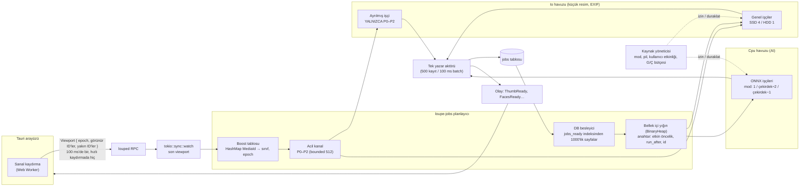
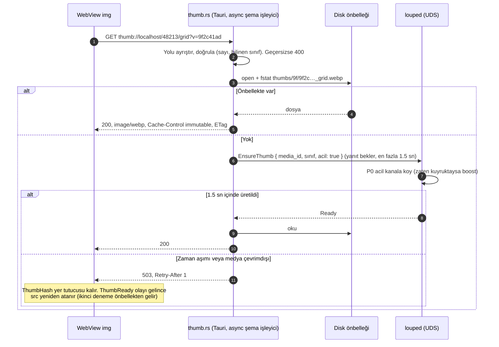
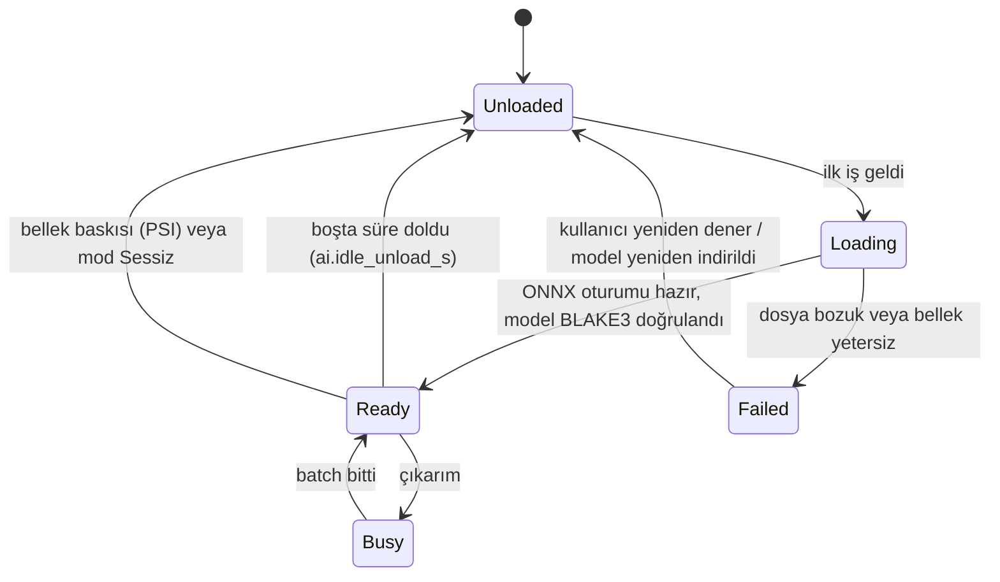
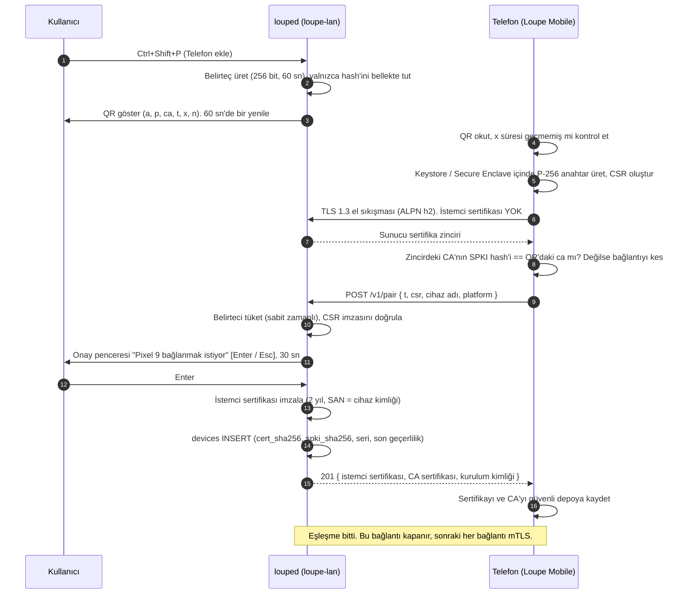
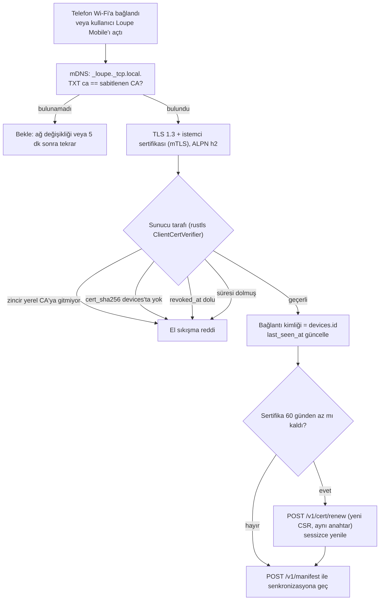
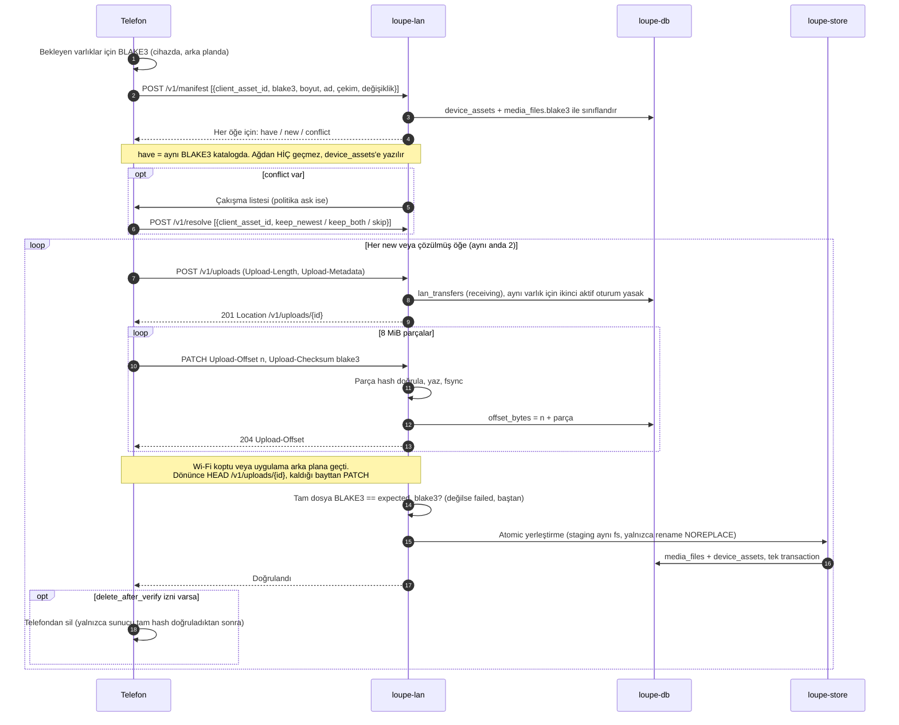
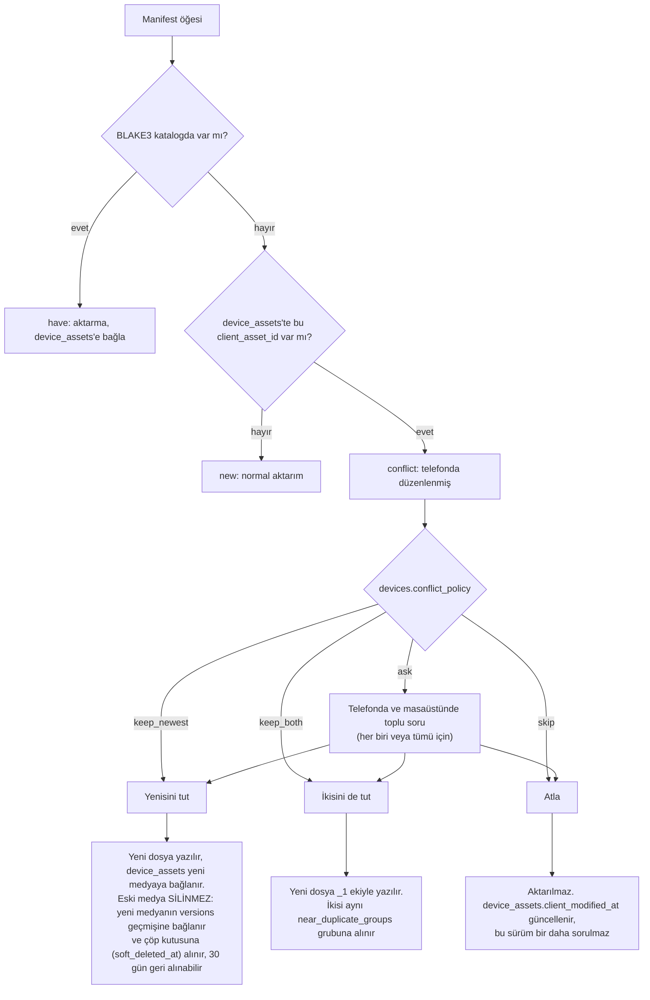
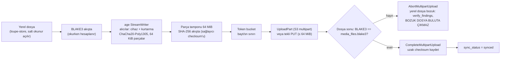
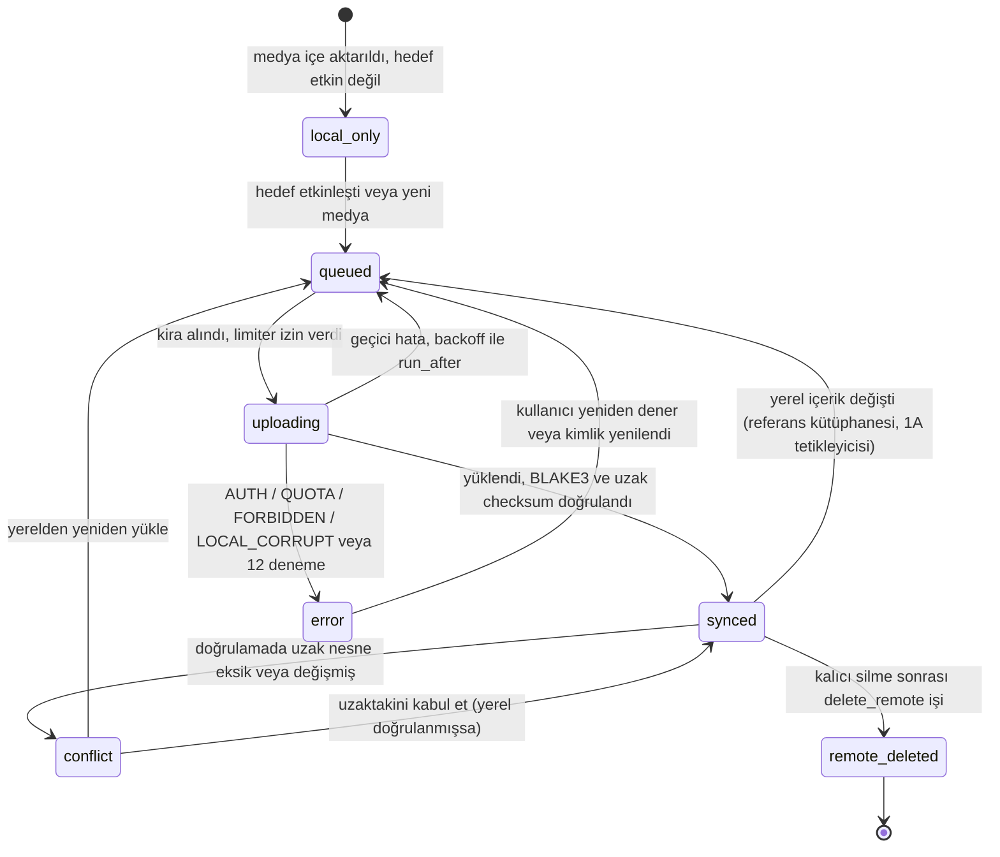

# RFC-001B — İş Kuyruğu ve AI, LAN Sync, Bulut Yedekleme, Tasarım Sistemi

| Alan | Değer |
|---|---|
| Durum | **Taslak — onay bekliyor** |
| Tarih | 2026-10-25 |
| Önceki | [RFC-001A — Veritabanı ve Depolama](RFC-001A-veritabani-ve-depolama.md) (onaylandı) |
| Kapsam | 1) Viewport öncelikli iş kuyruğu ve AI işçileri, `thumb://` protokolü · 2) LAN Sync güvenlik ve aktarım protokolü · 3) `age` şifreli bulut yedekleme hattı · 4) "No AI Slop" tasarım sistemi ve sanal kaydırma |
| Şema | [`0002_jobs_lan_cloud.sql`](../../crates/loupe-db/migrations/0002_jobs_lan_cloud.sql) (`jobs`, `sync_queue`, `devices`, `device_assets`, `lan_transfers`, `settings`) |
| Yapılandırma | [`apps/desktop/src/app.css`](../../apps/desktop/src/app.css) · [`layout.ts`](../../apps/desktop/src/lib/design/layout.ts) · [`slop-guard.sh`](../../tools/slop-guard/slop-guard.sh) |

**Adlandırma:** Proje adı Loupe olduğu için istekteki `mp-*` adları `loupe-*` olarak kullanılıyor: `loupe-jobs`, `loupe-ai`, `loupe-lan`, `loupe-cloud`. mDNS servis tipi `_loupe._tcp.local.`.

## 0. Varsayımlar

| # | Varsayım |
|---|---|
| V1 | RFC-001A'daki süreç modeli geçerli: diske yazan tek süreç `louped` daemon'udur; Tauri uygulaması ona Unix soketi (`$XDG_RUNTIME_DIR/loupe.sock`, `0600`) ile bağlanan bir istemcidir. |
| V2 | Telefon tarafında **yerel bir uygulama** (Tauri 2 Mobile, `loupe-lan` istemci kodunu paylaşır) vardır. mTLS ve sertifika sabitleme tarayıcıdan yapılamadığı için bu protokol PWA'yı kapsamaz. |
| V3 | Varsayılan donanım: GPU'suz, 4–8 çekirdekli x86_64, 16 GB RAM. GPU varsa ONNX Runtime CUDA / ROCm / OpenVINO sağlayıcıları isteğe bağlıdır. |
| V4 | Toplu tarama (100k dosya) ve onun ürettiği iş satırları, kullanıcının notuna uygun olarak **500'lük batch transaction'larla** yazılır; 0001'deki tetikleyiciler bu sayede her satır için ayrı fsync maliyeti üretmez. |
| V5 | Model ağırlıkları uygulamayla gelmez; ilk kullanımda bir kez indirilir (BLAKE3 doğrulamalı) veya çevrimdışı paket olarak verilir. Aşağıdaki bellek değerleri **yaklaşıktır** ve Adım 2'de ölçülerek güncellenecektir. |

---

## 1. Viewport Öncelikli İş Kuyruğu ve AI İşçileri

### 1.1 Modüller

```
crates/
├── loupe-jobs/    Planlayıcı: öncelik sınıfları, viewport boost, kira (lease), backoff,
│                  işçi havuzları, kaynak yöneticisi (CPU / G/Ç / pil / kullanıcı etkinliği)
├── loupe-thumb/   libvips + LibRaw + ffmpeg: küçük resim, ThumbHash, pHash girdisi
├── loupe-meta/    (1A) EXIF temel alanlar + tam döküm
├── loupe-ai/      ONNX Runtime oturumları, ModelManager (yükle/boşalt), RetinaFace,
│                  ArcFace, Multilingual-CLIP; yüz kümeleme
└── louped/        bağlama
apps/desktop/src-tauri/
└── thumb.rs       thumb:// protokol işleyicisi (önbellek okuma + daemon'a "acele" isteği)
```

`loupe-jobs` iş türlerini **bilmez**; her iş türü bir `JobHandler` trait'i uygular. Böylece kuyruk, küçük resim ve AI kodundan bağımsızdır:

```rust
// loupe-jobs (tasarım)
pub trait JobHandler: Send + Sync + 'static {
    const KIND: JobKind;
    const POOL: Pool;                       // Io (küçük resim, EXIF) | Cpu (AI) | Maint (kümeleme, sidecar)
    async fn run(&self, job: &Job, cx: &JobCx) -> Result<JobOutcome, JobError>;
}

pub enum JobOutcome { Done(DomainWrite), Skipped(SkipReason) }

#[derive(Debug, thiserror::Error)]
pub enum JobError {
    #[error("geçici hata, yeniden denenecek: {0}")]  Transient(#[source] Box<dyn std::error::Error + Send + Sync>),
    #[error("kalıcı hata: {code}")]                  Permanent { code: &'static str },
    #[error("iptal edildi (viewport değişti veya kapanış)")] Cancelled,
}
```

`JobCx` içinde bir `CancellationToken` vardır; uzun işler (RAW demosaic, video karesi, model çıkarımı) aşamalar arasında onu kontrol eder.

### 1.2 Öncelik sınıfları

| Sınıf | İş | Ne zaman |
|---|---|---|
| **P0** | `thumb/grid` | Şu an görünür ve küçük resmi yok |
| **P1** | `thumb/grid` | Görünür alanın ±1.5 ekran yakınında |
| **P2** | `thumb/preview` + `metadata_full` | QuickLook (Space) veya denetçi (I) açık olan medya ve sağ/sol komşuları |
| **P3** | `metadata_full`, `phash`, `geocode` | Yeni içe aktarılan (son 10 dk) |
| **P4** | `face_detect`, `clip_embed` | Görünür olan veya açık kişi/arama sayfasındaki medya |
| **P5** | `thumb/grid` | Kalan tüm kütüphane (toplu tarama) |
| **P6** | `phash`, `geocode`, `metadata_full` | Kalan tüm kütüphane |
| **P7** | `face_detect`, `clip_embed` | Kalan tüm kütüphane |
| **P8** | `cluster_faces`, `cluster_events` | Yeni yüz/medya birikince, 30 sn debounce |
| **P9** | `sidecar_write` | Kullanıcı alanı değişince (`sidecar_dirty`) |

`jobs.base_priority` iş oluşturulurken yazılır (P3, P5–P9). P0–P2 ve P4 **yalnızca bellekte** var olan *boost*'lardır: veritabanına yazılmaz, çünkü kullanıcı kaydırdıkça saniyede onlarca kez değişirler.

### 1.3 Planlayıcı mimarisi (preemption)



**Preemption nasıl sağlanır:**

1. **Ayrı acil kanal ve ayrılmış işçi.** Io havuzunda bir işçi yalnızca acil kanalı dinler. Arka planda 100.000 iş beklese bile görünür bir küçük resim en fazla *bir küçük resim süresi* (JPEG için ~10–30 ms) bekler.
2. **`biased` seçim.** Genel işçiler her döngüde önce acil kanala bakar:
   ```rust
   loop {
       let job = tokio::select! {
           biased;                                   // sıra önemli: önce acil
           _ = cx.shutdown.cancelled() => break,
           Some(j) = urgent_rx.recv() => j,
           Some(j) = background.next(&governor) => j,
       };
       run_one(job, &cx).await;                       // hata türüne göre: tamam / backoff / dead
   }
   ```
3. **İşbirlikçi kesme, zorla kesme yok.** Çalışan bir libvips çağrısı yarıda kesilemez; bu yüzden işler küçük tutulur. Uzun işler aşama aralarında `CancellationToken`'ı kontrol eder. Arka plan işi iptal edilirse `JobError::Cancelled` döner ve **deneme sayısı artmaz**.
4. **Bayat iş elemesi (epoch).** Her viewport mesajının bir `epoch` numarası vardır. Acil kanaldan çıkan bir P0/P1 işi, medya artık güncel viewport'ta değilse çalıştırılmaz; arka plan önceliğine geri düşer. Hızla kaydırılan 10.000 fotoğraf için iş birikmez.
5. **Hızlı kaydırmada istek yok.** Arayüz, kaydırma hızı 4 ekran/sn'nin üstündeyken viewport göndermez, yalnızca ThumbHash gösterir (`FAST_SCROLL_SCREENS_PER_S`).

**Kira (lease) ve çökme güvenliği:** İş alma tek SQL ifadesiyle atomiktir (`UPDATE … WHERE id = (SELECT … LIMIT 1) RETURNING`), 0002'deki `jobs_ready` indeksini kullanır. `lease_until` = şimdi + 60 sn; uzun işler 20 sn'de bir kirayı uzatır. Daemon çökerse kirası dolan iş açılışta `pending`'e döner. Başarılı iş satırı **silinir**; sonucu alan tablosunda yaşar (`thumbnails`, `media_ml_state`).

**Backoff:** `run_after = şimdi + min(1 sa, 2^deneme × 5 sn) × rastgele(0.5–1.0)`. `max_attempts` (varsayılan 5) aşılınca `dead`; arayüzde "Sorunlu dosyalar" listesinde görünür, sessizce kaybolmaz.

**Toplu tarama (V4):** 100k dosyalık ilk taramada `media_files` ve onların `jobs` satırları aynı 500'lük transaction'larda yazılır. Bu taramanın ürettiği küçük resim işleri P5'tir; kullanıcı zaman çizelgesinde gezindiği anda görünür olanlar P0'a çıkar.

### 1.4 Küçük resim hattı (libvips + LibRaw)

| Kaynak | Yol | Not |
|---|---|---|
| JPEG | `vips_thumbnail` **shrink-on-load** | Çözücü doğrudan 1/2, 1/4, 1/8 ölçekte açar; 24 MP JPEG tam çözülmez |
| HEIC/AVIF | libvips + libheif; gömülü küçük resim yeterliyse o | |
| RAW | LibRaw `unpack_thumb` → gömülü JPEG önizleme → libvips | `full` boyutu gerekip önizleme yetersizse LibRaw yarım boyutlu demosaic |
| Video | `ffmpeg` %10'daki anahtar kare | |

Boyut sınıfları (`layout.ts` → `THUMB_PX`): **`grid`** yükseklik 512 px (WebP q78, ~25–45 KB), **`preview`** uzun kenar 1600 px (WebP q82), **`full`** uzun kenar 2560 px (yalnızca QuickLook ve tam ekran). Arayüz gereken piksel = satır yüksekliği × `devicePixelRatio` ≤ 512 ise `grid`, değilse `preview` ister; 2x ekranda 256 CSS px'e kadar tüm satırlar `grid` ile karşılanır.

Önbellek: `$XDG_CACHE_HOME/loupe/thumbs/<blake3[0:2]>/<blake3>_<sınıf>.webp`. Dosya **önce geçici adla yazılıp `rename` edilir** (yarım küçük resim sunulmaz). Üst sınır `thumbs.cache_max_bytes` (8 GiB); dolarsa `thumbnails.last_access_at` ile LRU tahliye, `grid` en son silinir.

Aynı decode'dan, ek dosya okuması olmadan: **ThumbHash** (DB'ye, anlık yer tutucu) ve **pHash** girdisi (32×32 gri).

### 1.5 `thumb://` Tauri özel protokolü

JSON IPC ve base64 yok. WebView `` ile doğrudan protokolden okur.

**URL:** `thumb://localhost/<media_id>/<sınıf>?v=<blake3'ün ilk 8 hex'i>` (Linux'ta Tauri özel şemaları `şema://localhost/…` biçimindedir). `v` parametresi içerik değişince URL'yi değiştirir; böylece önbellek başlığı `immutable` olabilir.



**"Sıfır kopya" ne demek, sınırı ne:** Serileştirme sıfırdır (JSON yok, base64 yok, Rust→JS nesne dönüşümü yok); baytlar dosyadan doğrudan WebKit'in ağ katmanına gider ve görüntü çözme WebKit'in kendi iş parçacıklarında yapılır. Çekirdek sayfa önbelleğinden WebKit'e **bir** kopya kaçınılmazdır (Tauri `Response` gövdesi sahipli bayt ister); 40 KB'lık bir dosya için bu ihmal edilebilir. Ana JS iş parçacığı hiçbir bayta dokunmaz.

**Güvenlik:** `tauri.conf.json` CSP: `img-src 'self' thumb: data:`; işleyici yalnızca sayısal `media_id` ve sabit sınıf adlarını kabul eder, dosya yolu asla URL'den türetilmez (path traversal imkansız). Önbellek yolu `media_id → blake3` eşlemesi üzerinden, bellekteki LRU haritasından çözülür (DB'ye gitmeden).

### 1.6 AI işçileri ve model bellek yönetimi

| Model | Görev | Girdi | Biçim | Yaklaşık bellek (V5) | Ne zaman yüklü |
|---|---|---|---|---|---|
| RetinaFace-R50 (zayıf CPU: MobileNet-0.25) | Yüz tespiti + 5 nokta | 640 px | fp32 | ~110 MB (MobileNet ~2 MB) | Yüz işi varken |
| ArcFace R100 | 512-d yüz vektörü | 112×112 hizalı | fp16 | ~130 MB | Yüz işi varken |
| M-CLIP görüntü kodlayıcı (ViT-B/32) | 512-d görüntü vektörü | 224 px | fp16 | ~200 MB | CLIP işi varken |
| M-CLIP metin kodlayıcı (XLM-R Large) | 512-d sorgu vektörü | metin | int8 | ~600 MB | **Yalnızca arama yapılırken** |

> **Şema notu (PR #2 kararı):** Model M-CLIP `XLM-Roberta-Large-Vit-B-32`; iki kodlayıcı da 512 boyutlu ortak uzaya izdüşürür. 0001'deki 768 yanlıştı; migrasyon `0003_clip_dim.sql` `vec_media_clip`'i `float[512]` olarak yeniden oluşturur. Rust tarafındaki tek kaynak `loupe_db::CLIP_DIM = 512`; açılışta şema doğrulaması tablo tanımını bu sabitle karşılaştırır, uyuşmazsa veritabanı açılmaz.



**ModelManager kuralları:**

- **Tembel yükleme, `Arc<Session>` paylaşımı.** Bir model ilk iş geldiğinde yüklenir; aynı anda en fazla bir yükleme yapılır (yükleme sırasında gelen işler bekler).
- **Boşta boşaltma.** Son kullanımdan `ai.idle_unload_s` (300 sn) sonra oturum düşürülür. Metin kodlayıcı en pahalısıdır ve yalnızca arama anında gerekir: `ai.text_encoder_idle_unload_s` (120 sn).
- **Bellek bütçesi.** Varsayılan toplam ML bütçesi 1.5 GB. Yeni model bütçeyi aşacaksa en uzun süredir boşta olan boşaltılır. Linux **PSI** (`/proc/pressure/memory`) "some avg10 > 10" olursa tüm boşta modeller boşaltılır ve AI havuzu duraklar.
- **ONNX Runtime oturum ayarları:** `GraphOptimizationLevel::Level3`, optimize edilmiş graf diske önbelleklenir (ikinci açılış hızlı); `intra_op_num_threads` kaynak modundan; CPU bellek arenası açık ama `arena_extend_strategy = kSameAsRequested` (boşaltınca bellek gerçekten geri verilsin).
- **VRAM:** GPU sağlayıcısında `gpu_mem_limit` (varsayılan VRAM'in %50'si) ve aynı anda yalnızca **bir** model GPU'da; diğerleri CPU'da çalışır veya sırasını bekler. GPU başlatılamazsa sessizce değil, bir kez durum çubuğunda belirtilerek CPU'ya düşülür.
- **Batch:** CLIP görüntü 16'lık, ArcFace 32'lik batch; RetinaFace görüntü başına. Batch, viewport değişince bir sonraki sınırda kesilebilir.

### 1.7 CPU ve disk G/Ç sınırlama

| Mod (`resources.mode`) | AI iş parçacığı | CPU | Disk okuma (arka plan) | Varsayılan |
|---|---|---|---|---|
| Sessiz (`quiet`) | 1 | `CPUQuota=25%` | `ioprio idle` + 20 MB/s | Pilde |
| **Dengeli** (`balanced`) | çekirdek ÷ 2 | `CPUQuota=50%` | `ioprio idle` + 80 MB/s | **Evet** |
| Tam güç (`full`) | çekirdek − 1 | sınırsız | `best-effort`, sınırsız | Elle / gece |

- **CPU:** İşçiler ayrı bir systemd slice'ında (`loupe-workers.slice`); `CPUQuota` mod değişince D-Bus üzerinden `SetUnitProperties` ile anında güncellenir. Arayüz, LAN sunucusu ve thumb:// işleyici bu slice'ta değildir ve hiç kısılmaz.
- **Disk:** Arka plan okumaları `ioprio_set(IOPRIO_CLASS_IDLE)` ile ve süreç içi token bucket'la (MB/s) sınırlanır. cgroup `IOReadBandwidthMax` aygıt bazlı olduğu için (NAS ve çıkarılabilir disklerde değişir) kullanılmaz.
- **Kullanıcı etkinliği:** Arayüzden son 2 sn içinde girdi geldiyse P5–P9 duraklar (P0–P4 hariç). Pil < %20 (UPower) ise AI havuzu durur. Ölçülen kare süresi 16 ms'yi aşarsa (arayüz bildirir) Io havuzu geçici olarak tek işçiye iner.

---

## 2. LAN Sync Protokolü (`loupe-lan`)

### 2.1 Kimlik ve anahtarlar

| Malzeme | Nerede | Ömür |
|---|---|---|
| **Yerel CA** (ECDSA P-256) | Özel anahtar Secret Service'te (GNOME Keyring / KWallet) | 10 yıl |
| **Sunucu sertifikası** (CA imzalı, ECDSA P-256) | Özel anahtar Secret Service'te | 1 yıl, otomatik yenilenir |
| **İstemci anahtarı** (telefon) | Android Keystore / iOS Secure Enclave; **telefonu hiç terk etmez** | Kalıcı |
| **İstemci sertifikası** (yerel CA imzalı) | Telefonda; parmak izi `devices.cert_sha256` | 2 yıl, sessizce yenilenir |
| **Eşleşme belirteci** | Yalnızca daemon belleğinde, BLAKE3 hash'i ile | **60 sn, tek kullanım** |

P-256 seçildi çünkü iOS Secure Enclave yalnızca P-256 destekler. Telefon, sunucunun **yaprak sertifikasını değil CA'nın açık anahtarını (SPKI)** sabitler; sunucu sertifikası yenilenince yeniden eşleşme gerekmez.

### 2.2 mDNS keşfi

```
Servis:   _loupe._tcp.local.
Örnek:    Oğuz-Masaüstü._loupe._tcp.local.   port 47123
TXT:      v=1                         protokol sürümü
          id=6f1c9a2e4b7d0835         kurulum kimliği (rastgele 64 bit, hex)
          ca=Kq3…(22 karakter)        CA SPKI SHA-256'nın ilk 16 baytı, base64url
```

Telefon TXT'deki `ca` değeri sabitlediği CA ile eşleşen servisi seçer; aynı ağda birden fazla Loupe kurulumu karışmaz. IP değişse de keşif yeniden çözer. TXT'de kişisel bilgi yoktur; cihaz adı yalnızca servis örnek adındadır ve ayarlardan anonimleştirilebilir.

### 2.3 Dinamik QR kodu

```
loupe://pair?v=1
  &a=192.168.1.20,fd12:3456::20      erişilebilir adresler (yalnızca LAN: RFC1918, ULA, link-local)
  &p=47123
  &ca=<CA SPKI SHA-256, 43 karakter base64url>
  &t=<eşleşme belirteci, 256 bit, 43 karakter base64url>
  &x=1761394860                      son geçerlilik (unix sn) = üretim + 60
  &n=Oğuz-Masaüstü
```

- Ekran açıkken QR **her 60 sn'de yeniden üretilir**; yenisi üretilince eskisi anında geçersizdir. Aynı anda yalnızca bir belirteç geçerlidir.
- Belirteç **tek kullanımlıktır**: ilk `POST /v1/pair` denemesinde (başarılı ya da başarısız) tüketilir.
- Belirteç karşılaştırması sabit zamanlıdır; eşleşme uç noktasına IP başına dakikada 5 deneme sınırı vardır.
- QR yalnızca "Telefon ekle" ekranı açıkken üretilir; ekran kapanınca belirteç silinir.

### 2.4 İlk eşleşme: mTLS sertifika değişimi



Reddedilen, zaman aşımına uğrayan veya belirteci geçersiz eşleşmeler aynı yanıtı alır (`403 PAIRING_FAILED`); saldırgan hangi adımın başarısız olduğunu öğrenemez.

### 2.5 Sonraki bağlantılar: sıfır yapılandırma kimlik doğrulama



- Kullanıcı hiçbir şey yapmaz: aynı ağa giren telefon kendini bulur ve doğrular.
- İptal: Masaüstünde cihaz listesinden "Kaldır" → `revoked_at` dolar; doğrulayıcı her el sıkışmada bellekteki iptal kümesine bakar, yeniden başlatma gerekmez.
- Sunucu yalnızca LAN arayüzlerini dinler; kaynak IP RFC1918 / ULA / link-local değilse bağlantı TLS'ten önce kapatılır.

### 2.6 Aktarım: tus 1.0 (HTTP/2 over TLS)

Uç noktalar (`/v1` altında, hepsi mTLS gerektirir):

| Uç nokta | Amaç |
|---|---|
| `POST /v1/manifest` | Telefonun bekleyen varlık listesi → sınıflandırma (aşağıda) |
| `POST /v1/uploads` | tus **creation**: `Upload-Length`, `Upload-Metadata` (blake3, client_asset_id, ad, çekim ve değişiklik zamanı) |
| `HEAD /v1/uploads/{id}` | Kaldığı yer: `Upload-Offset` |
| `PATCH /v1/uploads/{id}` | 8 MiB parça; `Upload-Offset` + `Upload-Checksum: blake3 <base64>` |
| `DELETE /v1/uploads/{id}` | tus **termination** |
| `POST /v1/resolve` | Çakışma kararları |

tus uzantıları: `creation`, `checksum` (algoritma `blake3`; `Tus-Checksum-Algorithm: blake3,sha1`), `termination`, `expiration` (7 gün). HTTP/2 tek bağlantıda çoklama sağlar; telefon **aynı anda 2 dosya** yükler (Wi-Fi'da tek akış genellikle bağlantıyı doyurmaz).

**Sunucu tarafı yazma kuralı:** Parça → parça hash'i doğrulanır → `.part` dosyasına yazılır → `fsync` → **sonra** `lan_transfers.offset_bytes` güncellenir. Sunucunun söylediği offset diskte gerçekten vardır; elektrik kesintisinde bile. `.part` dosyası hedef kütüphanenin `.loupe-tmp/` dizinindedir (RFC-001A §3.5); bitince yalnızca `rename` yapılır, kopya yok.

**Kaynak sınırları:** Parça en fazla 8 MiB, istek gövdesi zaman aşımı 30 sn, cihaz başına en fazla 4 aktif yükleme, staging kotası kütüphane boş alanının %5'i.



### 2.7 Çakışma çözümü

**Çakışma tanımı:** Telefondaki bir varlık daha önce aktarılmış (`device_assets`'te `client_asset_id` var) **ve** BLAKE3'ü farklı (telefonda düzenlenmiş, ör. kırpma veya filtre). Sadece aynı dosya adı çakışma **değildir** (farklı telefonlarda `IMG_0001.JPG` doğaldır); o durumda yeni dosya `_1` ekiyle yazılır.



**Durum çubuğu (24 px, JetBrains Mono, tabular rakamlar):**
```
LAN ▸ Pixel 9 · 412/1 204 · 38.6 MB/s · ETA 00:04:12 · ✓ 409 doğrulandı · 3 atlandı · 1 çakışma
```
Hız, son 5 sn'nin üstel hareketli ortalamasıdır (titremez); ETA kalan bayt / hız. "Doğrulandı" yalnızca tam dosya BLAKE3 kontrolünden geçenleri sayar.

---

## 3. 3-2-1 Hibrit Bulut Yedekleme ve `age` Şifreleme (`loupe-cloud`)

### 3.1 Modüller

```
loupe-cloud/
├── provider/   OpenDAL Operator sarmalayıcı (S3, B2, R2, Wasabi, GDrive, OneDrive, WebDAV)
│               + rclone rcd adaptörü (Proton Drive). Ortak trait: RemoteStore
├── crypto/     rage (age) akış şifreleme, anahtar yönetimi, kurtarma anahtarı
├── uploader/   multipart / tekli yükleme, parça bazlı devam, checksum
├── verifier/   uzak doğrulama (HEAD + checksum, isteğe bağlı tam indirme)
├── limiter/    token bucket (bayt/sn ve istek/sn), AIMD
└── scheduler/  sync_queue kira, backoff, durum makinesi (sync_status ile konuşur)
```

### 3.2 Anahtar yönetimi

İki `age` alıcısı (recipient) kullanılır; her dosya **ikisine birden** şifrelenir:

| Anahtar | Üretildiği yer | Saklandığı yer | Amaç |
|---|---|---|---|
| **Cihaz anahtarı** (X25519) | Bu bilgisayar | Secret Service | Günlük şifreleme/çözme, kullanıcı hiç görmez |
| **Kurtarma anahtarı** (X25519) | Bu bilgisayar, bir kez | **Bilgisayarda saklanmaz**; yalnızca açık anahtarı (`age1…`) tutulur | Bilgisayar kaybolursa / keyring silinirse arşivi açmak |

Bu sayede bilgisayar tamamen kaybolsa bile kurtarma anahtarı ile tüm arşiv **uygulama olmadan bile** standart `age` aracıyla açılabilir:
```
age -d -i kurtarma-anahtari.txt objects/9f/2c/9f2c…41ad.age > DSC_0412.NEF
```

**Kurtarma anahtarı dışa aktarımı (şifreleme açılırken zorunlu akış):**
1. Uygulama kurtarma anahtar çiftini üretir ve gizli anahtarı (`AGE-SECRET-KEY-1…`) **bir kez** gösterir: metin + QR + yazdırılabilir PDF (monospace, 4'lü gruplar).
2. Kullanıcı anahtarın 3 rastgele grubunu geri yazarak kaydettiğini kanıtlar. Bu adım geçilmeden şifreleme etkinleşmez.
3. Gizli anahtar bellekten silinir (`zeroize`); bilgisayarda yalnızca açık anahtarı kalır.
4. İsteğe bağlı: kullanıcı bir parola belirlerse kurtarma anahtarı `age -p` (scrypt, iş faktörü 2^18) ile şifrelenip buluta `keys/recovery.age` olarak yüklenir. Böylece parolayı hatırlayan biri kâğıda gerek kalmadan da kurtarabilir.

**Anahtar rotasyonu:** Yeni cihaz anahtarı üretilir; yeni yüklemeler onunla yapılır (`sync_status.key_fingerprint`). Eski nesneler arka planda (P9 öncelikle) yeniden şifrelenir. Kurtarma anahtarı değişmedikçe hiçbir nesne erişilemez hale gelmez.

### 3.3 Şifreleme ve yükleme hattı



- **Geçici dosya yok:** Şifreleme ve yükleme akış halindedir; diskte şifreli kopya oluşmaz.
- **Bit-rot bulaşmaz:** Yüklenen baytların düz metin BLAKE3'ü katalogdakiyle karşılaştırılır; eşleşmezse yükleme iptal edilir ve Verify akışı (RFC-001A §3.8) tetiklenir. Bozuk dosya sağlam bulut kopyasının üzerine asla yazılmaz.
- **Uzak düzen:**
  - Şifreli: `objects/<blake3[0:2]>/<blake3[2:4]>/<blake3>.age` (dosya adı ve klasör yapısı bulutta görünmez) + günlük `manifest/<yyyy-mm-dd>.jsonl.age` (hash → orijinal yol, çekim zamanı, puan) + `keys/recovery.age` (isteğe bağlı).
  - Şifresiz: yerel ile aynı okunabilir ağaç (`2026/10/24/DSC_0412.NEF`) + nesne meta verisi `x-amz-meta-blake3`.
- **Checksum:** S3 uyumlularda `x-amz-checksum-sha256` (parça bazlı), B2'de SHA-1, OneDrive'da QuickXorHash, Google Drive'da MD5. `sync_status.remote_checksum_algo` hangisinin kaydedildiğini söyler.
- **Devam:** Her tamamlanan parçanın numarası ve ETag'i `sync_queue.multipart_parts`'a yazılır. Çökmeden sonra aynı `multipart_upload_id` ile eksik parçalardan devam edilir. age akışı deterministik olmadığı için (rastgele dosya anahtarı) **şifreli** yüklemede parça devamı yalnızca aynı süreç içinde geçerlidir; yeniden başlatmada multipart iptal edilip baştan başlanır (bu durum `multipart_upload_id` temizlenerek işaretlenir).

### 3.4 Rate limiting ve exponential backoff

**Hız sınırlama (`governor` crate):**
- **Bayt/sn:** Hedef başına (`cloud_targets.bandwidth_bps`) ve global (`cloud.global_bandwidth_bps`) iki token bucket; bir parça ikisinden de izin almadan gönderilmez.
- **İstek/sn (AIMD):** Sağlayıcı 429 / 503 / `SlowDown` dönerse o hedefin istek hızı yarıya iner; 60 sn hatasız geçerse %10 artar.
- **Bağlam:** Arayüz odaktayken bant genişliği yarıya iner; NetworkManager `Metered` = yes ise (mobil hotspot) `skip_metered` hedeflerde yükleme durur; `schedule` penceresi dışındaysa bekler.

**Hata sınıfları ve davranış:**

| Sınıf | Örnek | Davranış |
|---|---|---|
| `NET_TRANSIENT` | bağlantı sıfırlandı, zaman aşımı, DNS | Backoff ile yeniden dene |
| `THROTTLED` | 429, 503, `SlowDown` | `Retry-After` varsa ona uy, yoksa backoff + AIMD |
| `SERVER` | 500, 502, 504 | Backoff |
| `AUTH` | 401, süresi dolmuş OAuth | `error`; kullanıcıdan yeniden giriş, sonra otomatik devam |
| `QUOTA` | depolama dolu | `error`; o hedefin tüm kuyruğu duraklar |
| `FORBIDDEN` | 403, bucket yok | `error`, kalıcı |
| `LOCAL_MISSING` | yerel dosya çevrimdışı/yok | İş `run_after` = disk takılınca (VolumeEvent ile uyanır) |
| `LOCAL_CORRUPT` | BLAKE3 uyuşmuyor | `error` + Verify bulgusu |

**Backoff:** `run_after = şimdi + min(6 sa, 2^deneme × 30 sn) × rastgele(0.5–1.0)` (tam rastgele titreşim, eşzamanlı yeniden deneme fırtınasını önler). 12 denemeden sonra `dead`.

### 3.5 Durum makinesi (`sync_status` ↔ `sync_queue`)



**Tablo eşlemesi:**

| `sync_status.state` | `sync_queue` satırı | Arayüz mikro ikonu (`.sync-dot`) |
|---|---|---|
| `local_only` | yok | `data-sync="local"` (boş, `ink-3`) |
| `queued` | `upload`, `pending` / `failed` | `queued` (boş, kehribar) |
| `uploading` | `upload`, `running` | `queued` |
| `synced` | yok (başarılı iş silinir) | tüm etkin hedeflerde synced ise `synced` (dolu, `ink`) |
| `conflict`, `error` | `dead` veya yok | `error` (dolu, kehribar) |
| (kütüphane çevrimdışı) | | `offline` (çapraz 1 px çizgi) |

**Tek yazar ile tutarlılık:** Bir durum geçişi ve onun kuyruk değişikliği her zaman **aynı transaction'da** yazılır (ör. `synced` + `sync_queue` satırının silinmesi). Arayüz `v_*` sorguları yerine daemon'un bellekte tuttuğu medya başına 3 bitlik durum haritasını okur; değişiklikler olay olarak gönderilir.

**Uzak doğrulama:** Haftalık örneklem (her hedefte nesnelerin %2'si) `HEAD` ile boyut ve checksum kontrolü; ayda bir isteğe bağlı tam indirme + şifre çözme + BLAKE3. Uyuşmazlık `conflict_status = remote_changed`.

**Silme politikası:** Yerel çöp kutusu boşaltılınca uzak nesne **otomatik silinmez**; varsayılan "bulutta 30 gün daha tut" (`delete_remote` işi `run_after` = +30 gün). Kullanıcı ayarla değiştirebilir. 0001'deki `ON DELETE RESTRICT` bu sırayı veritabanı seviyesinde garanti eder.

---

## 4. "No AI Slop" Tasarım Sistemi ve Sanal Kaydırma

### 4.1 Dosyalar

| Dosya | İçerik |
|---|---|
| [`apps/desktop/src/app.css`](../../apps/desktop/src/app.css) | Tailwind v4 `@theme`: varsayılan ölçekler silinir, Darkroom paleti, tipografi, 4px ızgara, yarıçap üst sınırı, bileşen sınıfları (`btn`, `input`, `tile`, `sync-dot`, `palette`, `statusbar`, `kv`) |
| [`apps/desktop/src/lib/design/layout.ts`](../../apps/desktop/src/lib/design/layout.ts) | Web Worker'ın kullandığı sayısal sabitler (oluk, satır yükseklikleri, overscan, küçük resim boyutları) |
| [`tools/slop-guard/slop-guard.sh`](../../tools/slop-guard/slop-guard.sh) | CI koruması: yasaklı sınıf ve değerleri bulursa derlemeyi kırar |

Tailwind v4'te yapılandırma CSS içindedir; ayrı bir `tailwind.config.js` yoktur.

### 4.2 Kurallar ve nasıl zorlandıkları

| Kural | Değer | Zorlama |
|---|---|---|
| Arka planlar | `canvas #0A0A0A`, `surface #121212`, `raised #1A1A1A` | Varsayılan renk paleti `--color-*: initial` ile silindi; `bg-purple-500`, `bg-white` üretilmiyor |
| Çizgiler | `1px solid #262626` (`line`), tüm elemanlarda varsayılan kenarlık rengi | `@layer base` |
| Vurgu | Amber `#D97706` yalnızca işlev; kırık beyaz `#F5F5F7` metin ve birincil buton | Bileşen sınıfları; amber dekoratif kullanım kod incelemesinde |
| Yarıçap | `rounded-xs` 2px, `rounded-sm` 4px, başka yok | `--radius-*: initial`; `rounded-md…3xl` üretilmiyor. `rounded-full` Tailwind'de tema dışı sabit bir sınıf olduğu için CSS'ten silinemiyor, **slop-guard yakalıyor** |
| Gölge, blur, cam | Yok | `--shadow-*`, `--drop-shadow-*`, `--blur-*` silindi; `box-shadow`, `backdrop-filter`, `gradient(` slop-guard'da |
| Tipografi | Arayüz: Geist (yedek Inter), 13px varsayılan. Sayısal/EXIF: JetBrains Mono + `tabular-nums slashed-zero` | `--font-*: initial`; `font-serif` yok; `data` yardımcı sınıfı |
| Izgara | 4px taban (`--spacing: 4px`), fotoğraf oluğu 2px | `--spacing-gutter` |
| İkonlar | Lucide, 16px, `stroke-width: 1.5`, `absoluteStrokeWidth` | Tek `<Icon>` bileşeni (Adım 2) |
| Hareket | ≤ 120 ms, `cubic-bezier(0.2,0,0,1)`, sıçrama yok | `--animate-*: initial`; `animate-bounce/ping/pulse` slop-guard'da |

**Doğrulama (bu PR'da yapıldı):** `app.css` Tailwind 4.1.14 ile derlendi. Belirteç sınıfları (`bg-canvas`, `text-ink-2`, `rounded-sm`, `font-mono`, `p-3` = 12px, `h-control` = 28px, `w-sidebar` = 240px, `data`, `selected`…) üretiliyor; `rounded-md/lg/2xl`, `shadow`, `shadow-xl`, `drop-shadow-lg`, `backdrop-blur-md`, `blur-sm`, `bg-purple-500`, `text-blue-400`, `bg-white`, `animate-bounce`, `font-serif` **üretilmiyor**. Derlenmiş CSS'te `box-shadow` (Tailwind'in kendi `box-shadow: none` sıfırlaması dışında), `blur` ve `gradient` geçmiyor. slop-guard, bilerek kuralları çiğneyen bir test dosyasında 9 ihlalin hepsini yakaladı, `apps/desktop/src` üzerinde temiz.

### 4.3 Pencere düzeni

```
┌──────────────┬───────────────────────────────────────────────┬──────────────┐
│ Kenar çubuğu │ Araç çubuğu 40px                              │              │
│ 240px        ├───────────────────────────────────────────────┤  Denetçi     │
│ surface      │                                               │  320px       │
│              │  Zaman çizelgesi (canvas #0A0A0A)             │  I tuşu      │
│ Kütüphane    │  justified satırlar, 2px oluk                 │              │
│ Albümler     │                                               │  EXIF: kv    │
│ Kişiler      │                                               │  JetBrains   │
│ Yerler       │                                               │  Mono        │
│ Etkinlikler  │                                               │              │
├──────────────┴───────────────────────────────────────────────┴──────────────┤
│ Durum çubuğu 24px, mono: LAN · Yedekleme · Kuyruk · Kütüphane durumu        │
└─────────────────────────────────────────────────────────────────────────────┘
```

Açılışta doğrudan zaman çizelgesi; karşılama ekranı yok. Boş kütüphanede tek satır: `Kütüphane boş — bir klasör seçin  [Ctrl+O]`.

### 4.4 Justified (oranı koruyan) düzen algoritması

**Neden sütun masonry değil:** Sütunlu masonry'de göz yukarıdan aşağı akar ama zaman soldan sağa ilerler; kronolojik sıra bozulur. Satır tabanlı düzende her satır eşit yükseklikte, en-boy oranları korunur ve satırlar kenardan kenara dolar. Bento yalnızca etkinlik ve albüm kapak sayfalarında kullanılır.

**Tanımlar:** Kap genişliği `W`, oluk `g = 2`, hedef satır yüksekliği `Hₜ` (yakınlaştırmaya göre 120 / 180 / 260 / 380), öğe oranı `aᵢ = wᵢ / hᵢ` (EXIF yönlendirmesi uygulanmış; DB'deki `width`, `height`, `orientation`'dan).

`i..j` öğeleri tek satıra konursa satırın genişliği tam `W` olması için gereken yükseklik:

```
h(i, j) = (W − g · (j − i)) / Σₖ₌ᵢʲ aₖ
```

Öğe ekledikçe `Σa` büyür, `h` küçülür. **Açgözlü seçim:** `j`'yi artırırken `h` hedefin altına düştüğü anda dur; o ana kadar denenen her `j` için maliyet `|ln(h / Hₜ)|` hesaplanır ve `h ∈ [0.7·Hₜ, 1.5·Hₜ]` aralığındaki en düşük maliyetli `j` seçilir. Logaritmik maliyet, %20 kısa ve %20 uzun satırı eşit cezalandırır.

**Özel durumlar:**
- **Son satır:** Esnetilmez. `h = min(Hₜ, h(i, n−1))`, öğeler sola yaslanır.
- **Panorama:** Tek başına bile `h < 0.7·Hₜ` veren öğe (ör. `a = 6`) kendi satırına konur: `h = min(1.5·Hₜ, W / a)`.

**Piksel-tam yerleşim:** Kesirli genişlikler yuvarlanınca satır sonunda 1px boşluk veya taşma olur. Bunu önlemek için **kümülatif yuvarlama** kullanılır:

```
A  = Σ aₖ (satır),  L = W − g·(k−1)   (dağıtılacak genişlik)
xₘ = round(L · (a₁ + … + aₘ₋₁) / A) + g·(m−1)
wₘ = round(L · (a₁ + … + aₘ) / A) − round(L · (a₁ + … + aₘ₋₁) / A)
```

Son öğenin sağ kenarı her zaman tam `W`'dir; hata birikmez.

**Çıktı:** Worker sonucu tek bir `Float32Array` (öğe başına `[x, y, w, h]`, 100k için 1.6 MB) ve satır üst kenarlarını tutan `Float64Array` olarak ana iş parçacığına **transfer** edilir (kopyalanmaz, `postMessage(…, [buffer])`). Ay başlıkları (32px) ve bölüm boşlukları (16px) `y` hesabına dahildir; aylar ayrı ayrı yerleştirilir, böylece bir aya fotoğraf eklenince yalnızca o ay ve altındaki `y` ötelemesi yeniden hesaplanır.

**Ölçülen performans (bu PR'da yapılan deneme):** 100.000 öğe, `W = 1600`, `Hₜ = 180`, gerçekçi oran dağılımı (%55 yatay 3:2, %30 dikey 2:3, %13 kare, %2 panorama), ayda 800 fotoğraf. Node.js (V8) üzerinde tüm düzen **12.7 ms**. 14.252 satır (ortalama 7 fotoğraf/satır), tüm tam satırlar tam 1600px'te bitiyor, satır yükseklikleri 126–266px (beklenen aralık 126–270). Toplam belge yüksekliği ~2.6M px. WebKitGTK'nın JavaScriptCore'u V8'den birkaç kat yavaş olsa bile iş Worker'da olduğu için kaydırmayı etkilemez.

### 4.5 Sanal kaydırma matematiği (60/120 FPS)

**Kare bütçesi:** 120 Hz'de 8.3 ms. Kaydırma sırasında ana iş parçacığında yalnızca şunlar yapılır:

1. `requestAnimationFrame` içinde `scrollTop` (S) bir kez okunur (zorunlu düzen hesaplaması yok; kap yüksekliği sabittir).
2. Görünür aralık: `[S − O, S + V + O]`, `V` = görünür yükseklik, `O = 1.5 · V` (overscan).
3. İlk satır: `rowTops` üzerinde **ikili arama** → O(log R); 14k satırda ~14 karşılaştırma.
4. Aralıktaki satırların öğeleri, **sabit bir düğüm havuzuna** atanır. Her düğüm `position: absolute` ve yalnızca `transform: translate3d(x, y, 0)` + `width/height` ile konumlanır; düğüm eklenip silinmez, yeniden kullanılır.

**DOM'daki düğüm sayısı:**
```
N_düğüm ≈ (V + 2·O) / (Hₜ + g) × (W / (Hₜ · ā))
```
`V = 1000`, `W = 1600`, `Hₜ = 180`, ortalama oran `ā ≈ 1.3`: ≈ 22 satır × 7 ≈ **150 düğüm**. Kütüphane 1.000 veya 1.000.000 fotoğraf olsun, DOM'daki düğüm sayısı aynıdır.

**`.tile` sınıfı:** `contain: strict` (tarayıcı düğümün içini dışından bağımsız hesaplar), `will-change: transform` (kendi katmanında birleştirilir), `overflow: hidden`.

**Görüntü yükleme:**
- Gereken boyut = `h × devicePixelRatio` ≤ 512 → `grid`, aksi halde `preview`.
- `` + düğüm yeniden kullanılırken eski `src` hemen kaldırılır (yanlış fotoğraf bir kare bile görünmez); yerine ThumbHash'ten üretilmiş 32×32 yer tutucu `data:` URL'si.
- Hızlı kaydırmada (> 4 ekran/sn) yeni `src` atanmaz; yalnızca ThumbHash. Yavaşlayınca görünür alanın **merkezinden dışarıya** sırayla istenir (göz önce ortaya bakar).
- Viewport, 100 ms'de bir daemon'a bildirilir (§1.3); daemon P0/P1'i buna göre ayarlar.

**Yeniden boyutlandırma ve sabit çapa:** Pencere genişliği değişince düzen Worker'da yeniden hesaplanır. Ekranın en üstündeki görünür öğe "çapa" olarak alınır; yeni düzende `scrollTop = yeni_y(çapa) − (eski_y(çapa) − eski_S)`. Kullanıcı yerini kaybetmez.

**Tarih kaydırıcısı (scrubber):** Sağ kenarda, bölüm tablosundan (ay → `y`) doğrusal olmayan bir eşleme: her yıl en az 24px yer alır, fotoğrafı çok olan aylar orantılı büyür. Sürüklerken monospace balon: `2026 · EKİM`.

**Tarayıcı yükseklik sınırı:** Tarayıcılar bir elemanın yüksekliğini sınırlar (Chromium'da ~33.5M px; WebKitGTK'daki değer Adım 2'de ölçülecek). 100k fotoğraf ~2.6M px ile her motorda rahat sınırın altındadır; 1M fotoğraf ~26M px'e çıkar. Sınırı aşan kütüphanelerde kaydırma alanı ölçeklenir (`S_gerçek = S × k`) ve konumlar buna göre çevrilir; Adım 2'de 1M sentetik öğeyle test edilecek.

### 4.6 Klavye haritası

| Kısayol | Eylem |
|---|---|
| `Ctrl/Cmd + K` | Komut paleti ve arama (doğal dil dahil, CLIP metin kodlayıcısını yükler) |
| `Space` | QuickLook: önce `preview`, sonra `full` (P2 acil kanal) |
| `I` | EXIF / metadata denetçisi (`metadata_full` P2) |
| `← → ↑ ↓` | Gezinme: komşu öğe düzen dizisinden hesaplanır, DOM sorgusu yok; ↑/↓ aynı x'e en yakın öğe |
| `Enter` / `Esc` | Tam ekran / geri |
| `0`–`5` · `6`–`9` | Puan · renk etiketi |
| `P` / `X` / `F` | Seç / reddet / favori |
| `Ctrl + = / −` | Satır yüksekliği (120 / 180 / 260 / 380) |
| `B` | Yedekleme mikro ikonlarını gizle/göster |
| `Ctrl + Shift + P` | Telefon eşleştir (QR) |

---

## 5. Adım 2 için sıra önerisi

1. `loupe-core`, `loupe-db` (0001 + 0002, tek yazar, 500'lük batch), `loupe-store`, `loupe-volume`: RFC-001A.
2. `loupe-jobs` + `loupe-thumb` + `thumb://` + masaüstü zaman çizelgesi: **100k sentetik medyayla 120 FPS kapısı** (kare süresi ölçümü CI'da).
3. `loupe-lan` + Loupe Mobile iskeleti (eşleşme, tus).
4. `loupe-cloud` (önce S3 uyumlu + şifresiz, sonra age, sonra diğer sağlayıcılar).
5. `loupe-ai` (yüz, sonra CLIP).

## 6. Onay bekleyen kararlar

| # | Karar | Öneri |
|---|---|---|
| K1 | Telefon istemcisi | Tauri 2 Mobile (V2); PWA yok |
| K2 | QR geçerliliği | 60 sn, tek kullanım, ekran açıkken 60 sn'de bir yenilenir |
| K3 | Kurtarma | İki alıcılı age (cihaz + kurtarma), kurtarma anahtarı kağıda zorunlu, parolalı bulut kopyası isteğe bağlı |
| K4 | Uzak silme | Yerel kalıcı silmeden 30 gün sonra |
| K5 | Varsayılan kaynak modu | Dengeli (CPU %50, AI iş parçacığı = çekirdek ÷ 2) |
| K6 | Varsayılan yakınlaştırma | 180px satır yüksekliği |
| K7 | CLIP modeli | **Karar verildi:** M-CLIP XLM-R Large + ViT-B/32, 512-d (migrasyon 0003, `CLIP_DIM`) |
